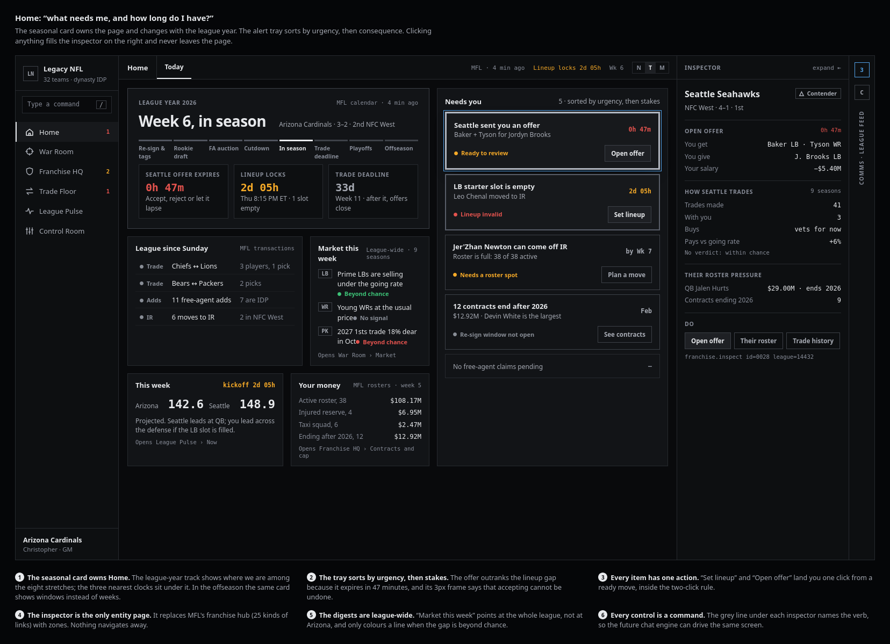
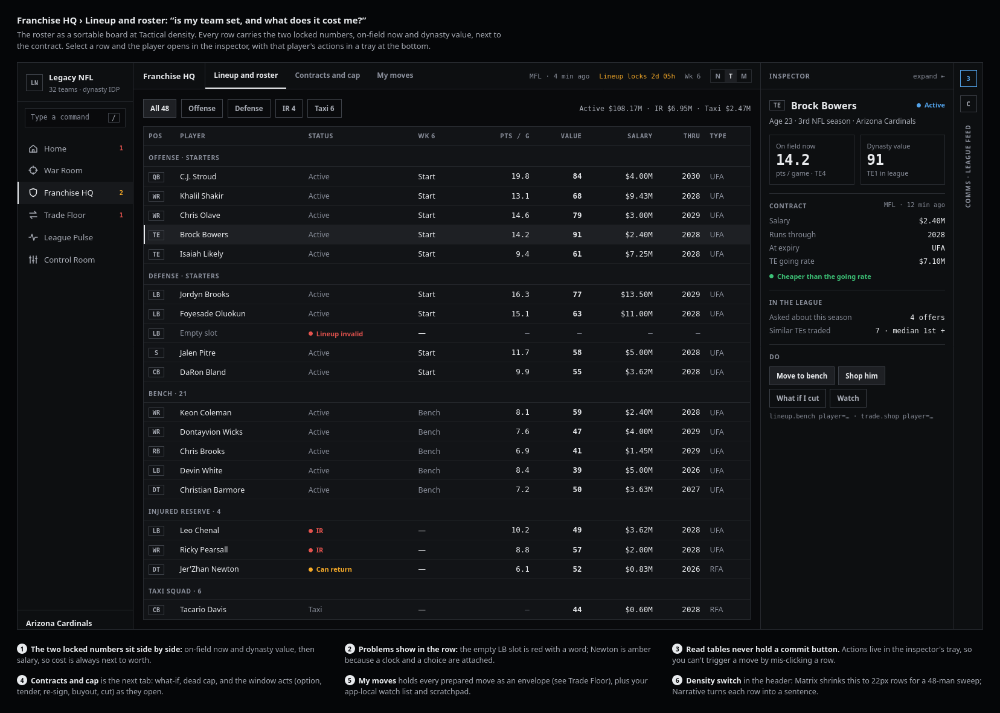
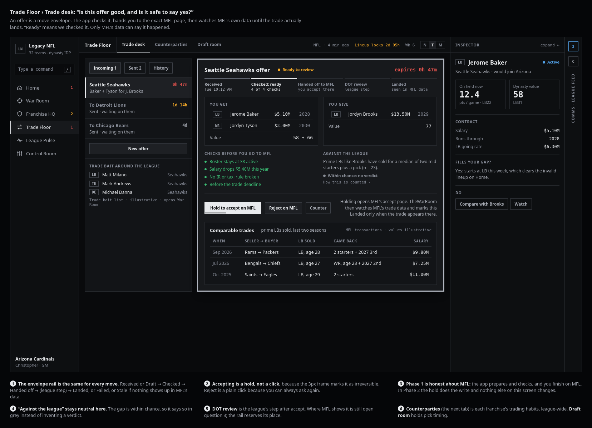
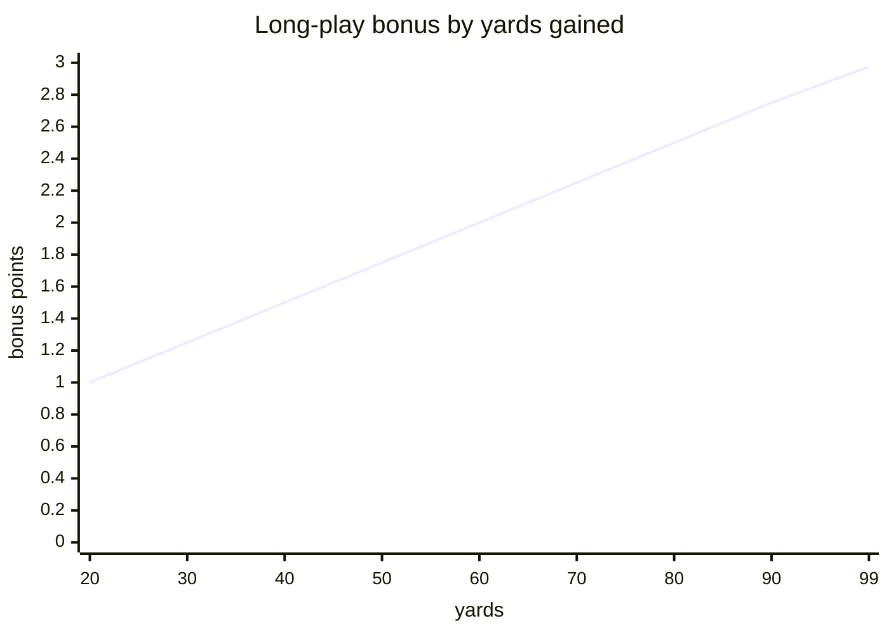
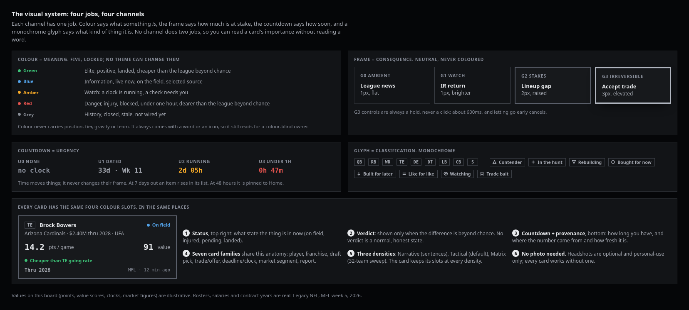
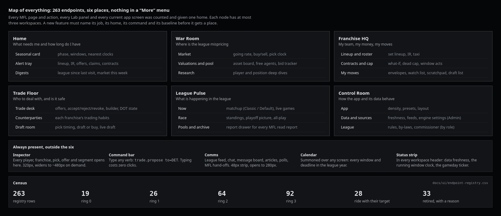
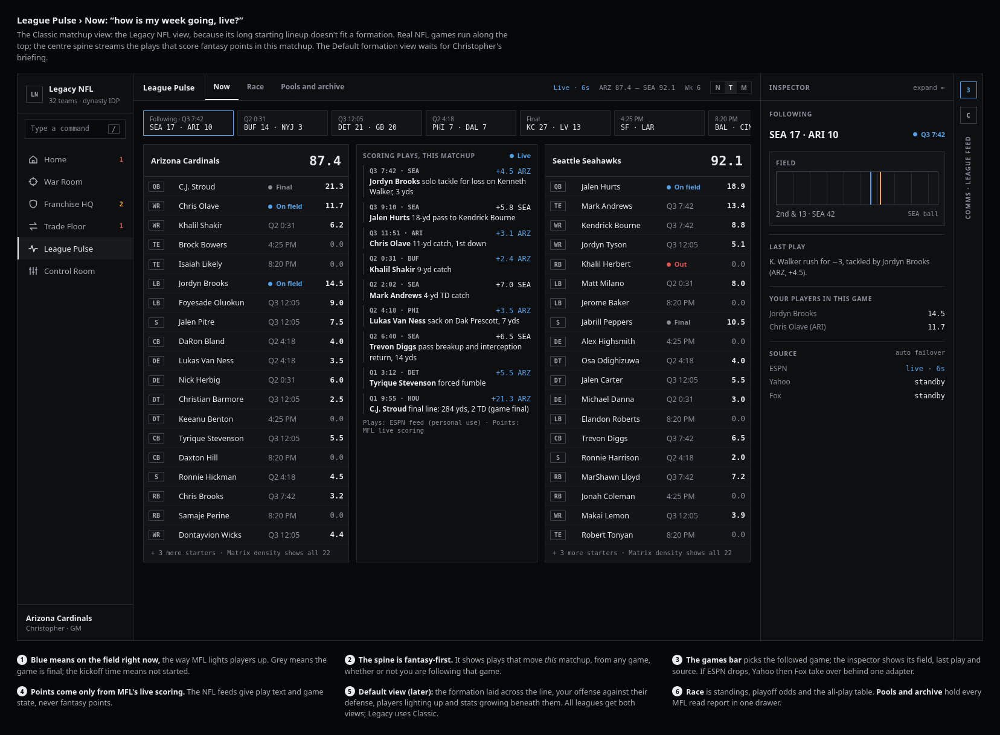

<div align="center">

# 🏈 TheWarRoom

### The front office, the league office and the stadium lights: one app, built for 32-team dynasty football

**A Go engine that knows every player, every contract and every cap dollar in a 32-team dynasty league. It values every player on the league's own scoring, and now it runs the league itself, on our own server, with every owner signing in from their own desktop.**

<br/>

[](#-the-league-server)
[](#-the-road-to-the-draft)

[](https://go.dev)
[](#-two-numbers-per-player)
[](#-the-native-league)
[](#-the-native-league)
[](#-the-vault-door)
[](#-it-cannot-lose-the-league)
[](#-the-command-line-and-ai-helpers)

[](https://wails.io)
[](https://react.dev)
[](https://sqlite.org)
[](https://alpinelinux.org)
[](https://cloudflare.com)

*32 teams. Five seasons of history. One league server. **Every owner, one front office.***

</div>

```
 ┌──────────────────────────────────────────────────────────────────────────────┐
 │  THEWARROOM // SYSTEM READOUT                                     2026-10-26 │
 │                                                                              │
 │  MODEL .......... FITTED     Now + Dynasty · 2021–2025 · holdout-checked     │
 │  HISTORY ........ STORED     ~1M values · 105 measures · append-only         │
 │  LEDGER ......... EXACT      int64 cents · hash-chained · $0.00 drift        │
 │  NATIVE LEAGUE .. HOSTED     draft · lineups · bids · waivers · trades · ✔   │
 │  LEAGUE SERVER .. BUILT      twr-server · Alpine · Cloudflare Tunnel         │
 │  SIGN-IN ........ LOCKED     invite codes · Argon2id · TOTP · device keys    │
 │  BACKUPS ........ ARMED      encrypted · Cloudflare R2 · every 15 minutes    │
 │  DESKTOPS ....... PACKAGED   Windows · Mac · Linux · signed self-updates     │
 │  AI HELPERS ..... LEASHED    twr CLI + MCP · scoped tokens · human confirms  │
 │  CLIENT/SERVER .. 50 / 52    two drills from release-candidate               │
 │  THE REVAMP ..... MAPPED     16 parts · a few big, tested branches           │
 │  OPENING DAY .... JULY 2027  the rookie draft, run through TheWarRoom        │
 └──────────────────────────────────────────────────────────────────────────────┘
```



<sub>🎯 **The target, Home: "what needs me, and how long do I have?"** The league-year track and its nearest clocks, an alert tray sorted by urgency and then stakes, and the counterparty open in the inspector. Rosters and contracts are the real league; points, values and clocks are illustrative.</sub>

---

## 📖 Contents

| | | |
|:--|:--|:--|
| ⚡ [The Hook](#-the-hook) | 🧠 [Two Numbers Per Player](#-two-numbers-per-player) | 🏟️ [The League Server](#-the-league-server) |
| 🏈 [The Native League](#-the-native-league) | 🆚 [Two Ways to Play](#-two-ways-to-play) | 🔥 [The 32-Team Default](#-the-32-team-default-built-from-the-data) |
| 🛡️ [The Vault Door](#-the-vault-door) | 💾 [It Cannot Lose the League](#-it-cannot-lose-the-league) | ⌨️ [CLI & AI Helpers](#-the-command-line-and-ai-helpers) |
| 🎛️ [The Console](#-the-console) | 🔧 [The Revamp](#-the-revamp-season-two-of-the-build) | 🏛️ [Architecture](#-the-architecture) |
| 🗺️ [The Road to the Draft](#-the-road-to-the-draft) | 🤖 [The AI Owners](#-horizon-the-ai-owners) | 🤝 [How It Gets Built](#-how-it-gets-built) |
| 🛠️ [Running It](#-running-it) |  |  |

---

## ⚡ The Hook

> MyFantasyLeague gives you a roster and a box score.
> **TheWarRoom gives you a front office, and then it gives the league its own stadium.**

Stock platforms and fragile spreadsheets fall apart the moment a league gets *serious*: 32 teams, per-year salary caps, multi-year contracts, dead cap, franchise tags, IDP scoring, and years of history that all have to reconcile to the penny. That isn't a fantasy app's job anymore. **That's a data system.**

TheWarRoom started as that data system, a front office for one GM. Then it kept going. **Now it hosts the league itself.** One server holds the one true ledger and runs the clock, the draft, the bids, the waivers, the trades and the season rollover. Every owner opens the app on Windows, Mac or Linux, signs in, and runs their franchise. No monthly platform bill. No one else's servers. **Our league, on our ground.**

### 🏟️ Why 32 teams

Every NFL franchise gets a GM. Rosters run deep, defenses score, the cap bites, and the waiver wire is thin. It's the closest thing to running a real front office, and it's where the serious players are heading. The platforms weren't built for it, and spreadsheets can't keep up. **TheWarRoom intends to lead that charge.**

---

## 🧠 Two Numbers Per Player

Every rostered player, rookies included, gets two values, both in **this league's fantasy points per game**:

| | The question it answers |
|:--:|:--|
| 🔥 **Now** | What does he score per game he plays, *this season*? |
| 🏛️ **Dyn** | What is he worth over this season and the next two (each later season counting 0.75 of the one before), times his chance of actually being on the field? |

Both come from one rule, the **credibility blend**: trust a player's production in proportion to how much of it there is.

```
                    ┌──────────────────────────────────────────────┐
   production ────► │  value = Z · production + (1 − Z) · prior    │ ────► 🔥 Now
   (league pts/g)   │                                              │
                    │        Z = games / (games + k)               │ ────► 🏛️ Dyn
   prior ─────────► │  k fitted per position · age via career arcs │   (+ survival,
   (pre-NFL facts)  └──────────────────────────────────────────────┘    3 seasons)
```

- 🎓 **The prior** is what his pre-NFL facts predict: draft slot, combine, college production, age at entry. It never sees a fantasy point, so it's a true second opinion.
- ⚖️ **k** is how many games before production outweighs the prior, fitted per position. A kicker's season says far less about his next than a quarterback's does, and the math knows it.
- ⏳ **Age enters once**, through a fitted career arc per position. A 31-year-old back and a 31-year-old quarterback with identical numbers are valued apart.
- 🐣 **Rookies are never zero.** Until he plays, a rookie is valued on his prior and on the chance a player drafted where he was takes the field.

### 🔬 Fitted, then checked on a season it never saw

The model is fitted on the league's own scoring history, 2021–2025. Every optional piece (the career arc, the recency weights, the survival model, the rookie debut chance) has to **beat its simpler alternative at predicting 2025 with 2025 held out**, or it doesn't ship.

```
   THE HOLDOUT — 2025, predicted blind from data through 2024, against the app's old board
   ─────────────────────────────────────────────────────────────────────────────────────
   TALENT    model wins 9 of 10 positions     RB .76 vs .53 · TE .80 vs .56   (rank corr.)
   ROOKIES   model ranks them .41 – .86       old board: every rookie scored zero
   KICKERS   nobody wins                      a kicker's season barely predicts his next
```

**No hiding the misses.** The kicker result sits in the [fit report](docs/fit/Fit_Report.md) right next to the wins.



<sub>🎯 **The target, Franchise HQ:** both numbers on every row, next to what the player costs and for how long. Values are illustrative.</sub>

---

## 🏟️ The League Server

> A front office for one is a tool. A front office for the whole league is a **platform.**

In October 2026 the client/server plan was written: **52 slices, about 102 engineer-days**, scheduled to run to a **build freeze on May 28, 2027**. Expert panels ruled on five gates before a line of server code existed.

**Within weeks, 50 of the 52 slices had landed on `main`**: each one reviewed, passed through CI, squash-merged, and click-tested in the real app where you can see it.

```
   🖥️ Owner desktops ×12+              ☁️ Cloudflare Tunnel               🏠 twr-server
   Windows · Mac · Linux      ──HTTPS──▶   no open ports at home  ◀────────  Alpine container
   your password + device key             no exposed IP                       the ONE ledger
   TOTP for the commissioners             outbound-only tunnel                owns every clock
        ▲                                                                        │
        │  ⚡ live updates: "something changed, re-read"  (never the raw ledger)  │
        └────────────────────────────────────────────────────────────────────────┤
                                                                                 ▼ every 15 min
                                                                    🔒☁️ encrypted backup → Cloudflare R2
```

**One brain, one ledger, one clock.** The server owns time. When you hit *Submit* on a bid at 11:59:59, the **server** decides whether it beat the deadline, and no desktop can fake a clock.

| Slices | What landed |
|:--:|:--|
| ✅ 01–12 | **The shared engine:** one HTTPS path, typed commands from one catalog, one mutation door, a server deadline worker, pinned stat evidence, native scoring |
| ✅ 13–22 | **Accounts:** invite codes, Argon2id passwords, TOTP, printed recovery codes, device sessions in the OS keychain, revoke one device or all |
| ✅ 23–26 | **Live and private:** hidden bids stay hidden everywhere, private-safe live updates, scoped AI tokens, the `twr` CLI and MCP |
| ✅ 27–33 | **Hardened:** request and login limits, input guards, a hash-chained ledger and security audit, checkpoints that catch a rewritten history |
| ✅ 34–38 | **The appliance:** one-command Alpine installer, sandboxed service, encrypted R2 backups, spare-host restore, health dashboard |
| ✅ 39–45 | **Moving day and delivery:** encrypted league export and safe moves, free signed updates (TUF), Windows, Mac and Linux packages |
| ✅ 46–50 | **The owner's season:** hosted lineups, draft, bids, waivers, trades, results and rollover, plus a matrix testing every command × every role |
| ▶ 51–52 | **The drills:** tunnel, deploy and update-tamper drills, then three-OS novice installs and a full 12-owner dress rehearsal |

---

## 🏈 The Native League

The native league is the real thing: a league whose **record of truth is TheWarRoom's own ledger**, not a mirror of somebody else's. Every move is a command, every command is checked against the rulebook, and every result is written once, forever.

| The season | Hosted on the league server |
|:--|:--|
| 🎓 **The rookie draft** | The draft room, the clock and the picks, live for every owner at once |
| 📋 **Lineups and rosters** | Set your lineup, move players to IR and taxi, all legality-checked |
| 💰 **Free-agent bids** | Sealed bids that **nobody can peek at**, not even the commissioner, until the reveal |
| 🔄 **Waivers** | Claims processed by the server at the deadline it owns |
| 🤝 **Trades** | Offered, accepted and landed atomically: both rosters at once, or neither |
| 🧮 **Results and standings** | Scored natively from pinned stat evidence, distance bonuses and kicker rules included |
| 📅 **Season rollover** | Contracts age, free agents promote, the new league year opens. One confirmed action, with a receipt |

**Money is exact.** Every contract is a row of per-year cells in `int64` cents. The cap is *derived* from those cells, never stored as a competing number. Priced moves **quote before they commit**, so you see "this will commit" or the exact reason it won't before anything is written. **Irreversible moves are a hold-to-confirm gesture, never a click.**

**Commissioners stay in charge.** The commissioner and every co-commissioner, in a set order of succession, have the full toolkit: corrections recorded as corrections, overrides with a reason, and a **"needs a ruling"** state for when the rulebook runs out. The human decides; the ledger remembers.



<sub>🎯 **The target, Trade Floor:** an incoming offer with its checks, the league's comparable trades, and the hold-to-accept gate. Real rosters and salaries; values are illustrative.</sub>

---

## 🆚 Two Ways to Play

TheWarRoom will ship with **two default league modes**, ready to go on day one, so a new league can start in minutes instead of a season of setup.

### 🪞 The Mirrored Conference League

**32 teams. Two conferences. Two full player pools. One champion.**

```
          🔵 AFC SIDE · 16 teams                      🔴 NFC SIDE · 16 teams
     ┌──────────────────────────────┐           ┌──────────────────────────────┐
     │  its own copy of EVERY NFL    │           │  its own copy of EVERY NFL    │
     │  player · each owned once     │           │  player · each owned once     │
     │  trades & moves stay inside   │           │  trades & moves stay inside   │
     └──────────────┬───────────────┘           └───────────────┬──────────────┘
                    │      ◀──── the schedule crosses over ────▶   │
                    └────────────▶  🏆 SIDE CHAMPS MEET  ◀─────────┘
                                     IN THE FINAL
```

- **Everybody can own a star.** Each side has its own full pool, so the AFC side and the NFC side can each have someone holding the league's best quarterback.
- **Your market is your conference.** Trades, bids and waivers only happen inside your side, so every deal is with the 15 rivals you know best.
- **The games cross over.** The schedule plays across both sides like a normal season.
- **One final.** Each side crowns a champion, and the two meet for the title.

It's the simplest way into 32-team dynasty and the format built to bring new people in.

### 🏛️ The Legacy Mode

The flagship grows out of the Legacy league this whole project was born in. It keeps the deep contracts, per-year caps and full rulebook, and adds a default lineup, roster and scoring rebuilt from three seasons of play-by-play data. **See [The 32-Team Default](#-the-32-team-default-built-from-the-data) below.**

---

## 🔥 The 32-Team Default: Built From the Data

**Most fantasy defaults are a guess, copied from the last platform's guess. Ours came out of the data.**

We rescored three full NFL seasons (2023–2025) play by play from free public stats. The rescoring matched our own league's archived scores on **99.9% of more than 35,000 player-weeks**. Then we tested scoring rules one lever at a time against a single question: *how many truly startable players does a 32-team league really have, and is a defender's week worth as much as a receiver's?*

Three rules came out of it:

> 🧨 **Big plays stay big.** Sacks, picks and forced fumbles keep their full value. Special players get to come up big.
> ⚖️ **Match them, don't dampen them.** Defensive splash plays are offset by offensive splash plays: long gains and workhorse games.
> 🧱 **Scarcity does the balancing.** The lineup and roster make good starters hard to find. Scoring is left free to be fun.

### 📋 The lineup: 19 starters, lots of flex

```
  OFFENSE  ·6   [QB] [RB] [WR] [FLEX] [FLEX] [FLEX]          flex = RB / WR / TE
  SPECIAL  ·2   [O-LINE] [K]
  DEFENSE  ·11  [DT] [DE] [LB] [CB] [CB] [S] [FLEX]×5      flex = any defender
```

There are no caps on what fills a flex. Three tight ends? Six safeties? Your call. And like every setting here, it is only the default: a commissioner can reshape the lineup any way they like.

### 👥 The roster: up to 64 deep

| 👥 Active | 🌱 Taxi | 🩹 IR |
|:--:|:--:|:--:|
| **44**, with your O-Line counting as one | **8**, for a player's first 3 NFL seasons only (CFL years don't count) | **12**, official NFL IR or PUP only |
| About 1.3 backups per starter, so byes are covered from your own bench | Moves in-season, and promotes automatically when his time is up | Tradeable, and he returns to active automatically when healthy |

### 🧱 New position: Team O-Line

You start a real NFL team's **entire offensive line**: one unit, scored as a group.

| 🏃 +1 per 25 yards before contact | 💨 +1 per 10+ yard run | 🙌 +1 per rushing TD | 📏 +1 per short-yardage conversion |
|:--:|:--:|:--:|:--:|
| 🛡️ **+2 for a clean game (no sacks)** | 💥 −1 per sack allowed | 🤕 −¼ per QB hit allowed | ⛔ −½ per run stuffed for a loss |

- **It's built to add flavour, not decide your week.** Nine games in ten land between −10 and +10, and every game is capped at ±15.
- **Every team owns exactly one O-Line**, on a 1-year deal. They're traded one for one, and a bye week scores zero, so you have to plan ahead.
- **It's also an early warning for the commissioner.** An owner who never manages his line is an owner drifting away.

### 🚀 Chunk plays pay by the yard

Legacy paid long plays in two flat steps. Now **every yard past 20 adds to the bonus**: +1 at 20 yards, +1.5 at 40 and +2 at 60, and a 99-yard house call earns almost +3.



### 🦶 Kickers pay by distance

**Field goals score 3 points up to 40 yards, then +0.1 for every yard past it.** A miss costs −0.1 for every yard short of 60, so shanking a chip shot hurts and missing a 58-yarder barely stings.

| FG distance | 30 | 40 | 45 | 50 | 55 | 60 |
|:--|:--:|:--:|:--:|:--:|:--:|:--:|
| ✅ **Made** | 3.0 | 3.0 | 3.5 | 4.0 | 4.5 | 5.0 |
| ❌ **Missed** | −3.0 | −2.0 | −1.5 | −1.0 | −0.5 | 0 |

### 📊 The scorecard

| 🏈 Offense | Pts | | 🛡️ Defense | Pts |
|:--|:--:|:-:|:--|:--:|
| Rush/rec TD · pass TD | 6 · 5 | | 💥 Sack | **4.5** |
| Catch · **TE catch** 🆕 | 1 · **1.2** | | 🧤 Interception (CB/S 6) | **5** |
| Rush/rec yards | 1 per 10 | | 👊 Forced fumble | **4** |
| 🚀 20+ yard play 🆕 | **+1 → +3** | | ⛔ Tackle for loss | 2.5 |
| 🐎 20+ touches in a game 🆕 | **+3** | | 🤼 Tackle (DT/DE 3, CB/S 2.5) ⬆️ | **2** |
| ↩️ Return yards ⬆️ | **1 per 20** | | 🤝 Assist (DT/DE 1.75) ⬆️ | **1.25** |
| INT thrown · fumble | −2 | | 🙅 Pass defended | 2.5 |
| | | | 🏆 Safety | 10 |

The preset also scores conversions, red-zone work, snaps and other edge stats, plus a weekly
rushing-loss adjustment. See the [shipped scoring spec](docs/architecture/default32-scoring.md)
for values, positions and sources. The study results below predate those additions.

### ⚖️ Offense and defense, finally even

| Average points per starter | 🏈 Offense | 🛡️ Defense | Defense vs offense |
|:--|:--:|:--:|:--:|
| Legacy scoring | 12.9 | 11.6 | 🟥🟥🟥🟥🟥🟥🟥🟥🟥⬜ **0.90** |
| **The new default** | **13.4** | **13.5** | 🟩🟩🟩🟩🟩🟩🟩🟩🟩🟩 **1.00** |

### 🌟 What it means for real players (2024, weeks 1–13)

| Player | Role | Legacy | **Default** | |
|:--|:--|:--:|:--:|:--|
| Saquon Barkley | RB · workhorse | 350 | **379** | 🟦 +29 from 20-touch games and long runs |
| Zaire Franklin | LB · tackle machine | 223 | **276** | 🟥 +53, the defensive match for a star RB |
| A'Shawn Robinson | DT · run stuffer | 166 | **190** | 🟥 +24 |
| Trey Hendrickson | DE · pass rusher | 195 | **209** | 🟥 his 51-point sack-fest is now **53** |
| Ja'Marr Chase | WR · deep threat | 298 | **300** | 🟦 every 20–39 yard catch now pays more |
| Chris Boswell | K · long-range leg | 151 | 142 | 🟩 still the #1 kicker |

**Stars stay stars.** Contenders stock up. Rebuilders take their zeros. That's 32-team football. And like everything in TheWarRoom, **every number here is a default the commissioner can change.**

---

## 🛡️ The Vault Door

> Every owner trusts this thing with their team. **So every door was locked from the inside before anyone was invited in.**

Security here is **proportionate**: this is a recreational league, so TheWarRoom is built to never be the weak point, without turning a fantasy league into a bank.

| Lock | How it works |
|:--|:--|
| ✉️ **Invite-only** | The commissioner hands you a one-use code, valid 48 hours. There is no sign-up page |
| 🔑 **Passwords** | Argon2id, login throttles, and a cap on hashing work so nobody can flood the server |
| 📱 **TOTP for commissioners** | An authenticator code for anything privileged |
| 🧾 **Recovery codes** | Eight printed one-time codes. Lose your phone, not your franchise |
| 💻 **Device sessions** | Kept in your computer's keychain. Revoke one device or all of them, and their queued writes die too |
| 🎭 **Every command knows its role** | All **101 league-changing commands** are checked against owner, commissioner, co-commissioner and AI-helper modes on every path. A denied attempt changes **nothing** |
| 🙈 **Hidden bids stay hidden** | Not in the screens, not in live updates, not even in change-detection tokens |
| ⛓️ **Tamper-evident history** | The ledger and the security audit are hash-chained, and checkpoints catch a rewritten history |
| 🧱 **A sandboxed server** | Non-root, no capabilities, one writable folder, default-deny firewall |

---

## 💾 It Cannot Lose the League

> **The league is the rosters and the contracts.** Everything here exists to protect them.

```
   ⏱️  RPO  15 minutes     the most play you can ever lose
   🛠️  RTO   4 hours       the longest the league can ever be down, new hardware included
```

- **🔒 Encrypted before it leaves the house.** Every 15 minutes the server seals a backup and ships it to **Cloudflare R2**, then downloads it again to prove it's good. If a backup goes overdue, the league pauses writes rather than risk them.
- **🚑 Spare-host restore.** A dead server is a runbook, not a disaster: install fresh, run `twr-restore`, and the newest good set comes back, checked against the saved checkpoint.
- **🚚 Moving day is safe.** Export a league encrypted, import it inactive, seal the source, activate the target. A crash at any step leaves exactly one live league.
- **🩺 A health dashboard.** `twr-status` shows backups, history chains, the tunnel, the clock and the disk at a glance ([checklist](deploy/server/CHECKLIST.md)).
- **🔜 Coming in the revamp:** a standalone **rosters-and-contracts restore point**, a recovery log for every league, and one tested **"stand the league back up"** command that a commissioner can run.

---

## ⌨️ The Command Line and AI Helpers

Every button in TheWarRoom is a command. The native league already runs on **one catalog of 136 typed commands** behind one mutation door, so the screen, the terminal and an AI helper reach the same rules, the same checks and the same ledger.

```
   $ twr connect --address https://league.example --league native.example
   $ twr ledger                      # the league's recorded changes
   $ twr preview CHANGE.json         # what a change would do; records nothing
   $ twr execute CHANGE.json         # records it; big moves need the commissioner's code
   $ twr mcp                         # hand the league to an AI helper over MCP
```

A commissioner connects a helper from the app, picks **"look and suggest"** or **"also record"**, and picks which franchise it works for. The helper gets a scoped token: read and preview for 30 days, execute for 24 hours. **An AI never signs in, never makes its own tokens, and never confirms a change on its own.** The ledger marks every move it touches **"via AI"**. ([`cmd/twr`](cmd/twr/README.md))

---

## 🎛️ The Console

The bar is **Anduril, not SaaS**: dark, precise, data-dense, with no wasted pixel. Every control actuates something real. **Plain words for every owner; full depth for every expert.**



**Four jobs, four channels.** Colour says what something *is*. The frame says how much is at stake. The countdown says how soon. A glyph says what kind of thing it is. No channel does two jobs, so a card's gravity reads before a single word does.

**Six places**: Home, War Room, Franchise HQ, Trade Floor, League Pulse and Control Room, with the inspector, command bar, comms, calendar and status strip always present.



- **⚡ Snappy is law.** Every control acknowledges in under 100 ms. Skeletons over spinners.
- **🪜 Three altitudes.** *Glance* reads the league from colour alone, *Operate* is the working tier, and *Interrogate* puts every number on screen. Depth is **discovered, never demanded**.
- **🏟️ Game Day.** The real NFL games run along the top, and the centre spine shows every play that moves *your* matchup, from any game.



📐 The spec: [`docs/ui/Target_UI_Spec_2026-10.md`](docs/ui/Target_UI_Spec_2026-10.md)

---

## 🔧 The Revamp: Season Two of the Build

> We sprinted to a working platform. **Now we build it better, from the inside out.**

Hundreds of build sessions got TheWarRoom to about **180,000 lines** and a working league server. With the platform standing, the next phase turns inward. Three independent AI mappers walked the entire codebase, and every subsystem was laid out, questioned and locked into a **16-part plan**, built in a few big, tested branches.

| | Part | The upgrade |
|:--:|:--|:--|
| ⌨️ | **One command spine** | One standard registry that every button, CLI line, chat and AI helper runs through, enforced by CI |
| 🧠 | **One shared brain** | League logic moves into shared services, so desktop, server and CLI run the exact same code |
| 💾 | **Recovery first** | Rosters and contracts restorable on their own, with a recovery log and a one-command stand-up |
| 🪪 | **Our own player IDs** | TheWarRoom's own identity for every player, with every outside source linked to it |
| 📡 | **The widest stat suite** | A native stats pipeline built for depth and speed, down to QB hits and first downs, with IDP, play-level and live corrections |
| 🏈 | **The league core, rebuilt** | The native league split into clean domains: market, governance, rules, draft, competition, season |
| 📈 | **Sharper valuations** | Named, versioned value products, tuned native-first, with the research lab moved out of the app |
| 🎨 | **A screen scorecard** | Every screen rated against the build philosophy: speed, plain words, no dead space, every button a command |

**The laws don't change:** a CLI back end, every button a command, minimal code, lightning fast, and **non-technical owners first without ever limiting the experts.**

---

## 🏛️ The Architecture

The boundaries aren't conventions; they're **compiler-enforced**. A violation is a build failure, not a code-review note.

```
   ┌────────────────────────────────────────────────────────────────────────────┐
   │   OWNER DESKTOPS  ·  Wails v2 + React                 ⌨️ twr CLI · 🤖 MCP    │
   │   Home · War Room · Franchise HQ · Trade Floor · League Pulse · Control    │
   └──────────────┬────────────────────────────────────────────┬────────────────┘
                  │  HTTPS + JSON  ·  live change notices       │ scoped tokens
   ┌──────────────▼────────────────────────────────────────────▼────────────────┐
   │   twr-server  ·  sign-in & device sessions  ·  role check on every command  │
   │   ONE catalog of commands  →  ONE mutation door  →  ONE writer               │
   │   server-owned clock  ·  deadline worker  ·  hidden-bid privacy             │
   └──────────────┬──────────────────────────────────────────┬──────────────────┘
                  │                                          │
   ┌──────────────▼───────────────┐          ┌───────────────▼──────────────────┐
   │   THE LEAGUE RULES + MODEL    │          │   THE LEDGER & STORAGE            │
   │   native scoring · legality   │◄─────────│   SQLite WAL · append-only        │
   │   fitted credibility blend    │          │   hash-chained · pinned evidence  │
   └──────────────▲───────────────┘          └───────────────▲──────────────────┘
                  │                                          │
   ┌──────────────┴──────────────────────────────────────────┴──────────────────┐
   │   DATA  ·  nflverse · DynastyProcess · CollegeFootballData · MFL reference  │
   │   105 measures · every download saved and fingerprinted before it's read   │
   └────────────────────────────────────────────────────────────────────────────┘
```

- **One writer.** A single path changes league state.
- **Immutable history.** Every result is appended, never edited, and every model run records the settings and inputs it used.
- **Evidence you can replay.** Every downloaded file is saved and fingerprinted before it's parsed, so any number can be traced to its source.
- **A walkable tree.** Every feature lives in `internal/app/<feature>`, and CI fails any file that isn't indexed. Find anything in two hops: [`SYSTEM_MAP.md`](SYSTEM_MAP.md).

```
   BY THE NUMBERS   ~122,000 lines of Go · ~106,000 lines of Go tests · ~56,000 lines of TypeScript
                    604 commits · 136 typed league commands · 3 desktop platforms · 1 league server
```

---

## 🗺️ The Road to the Draft

```
   ✅ THE CORE ──────────────────────── fitted model · Now + Dyn · exact ledger
   ✅ THE TRUTH PASS ───────────────── ledger replay: 2,000 events from 135 s → 66 ms
   ✅ CLIENT/SERVER 01–50 ──────────── the league server, end to end
   ▶  51–52 ────────────────────────── the final drills and the 12-owner dress rehearsal
   🔧 THE REVAMP ───────────────────── 16 parts, built in a few big, tested branches
   🔒 MAY 28 2027 ─────────────────── build freeze
   ✉️ JUN 25 2027 ─────────────────── invitations go out
   🏈 JULY 2027 ───────────────────── THE ROOKIE DRAFT, run through TheWarRoom
```

**On the horizon:**

- 🚪 **The MFL import door.** Bring an existing league over without losing a roster, contract or pick.
- 🗣️ **The Capologist.** Ask *"What's my dead cap in 2028 if I cut him?"* and get the answer from the actual ledger, **with receipts**.
- 🎖️ **The January War Room.** **Fork your franchise** and branch offseason futures like code, each run through the real rules.
- 🎟️ **Side games.** Pools, pick'em and survivor are planned.

### 🤖 Horizon: the AI Owners

**Finding thirty-two people who will run a franchise with real effort, for years, is hard.** Owners burn out. Life happens.

The append-only ledger is *already* a behavioral record: every bid war, every snipe, every cut where a GM ate the dead cap. From it the engine can derive a **GM fingerprint**: risk appetite, time horizon, where the cap actually goes, how early or late he moves. **An empty franchise gets a caretaker who plays like the league plays**, under the same role checks and the same penny-exact ledger as a human. **No AI owner gets a rule a human doesn't get.**

> A 32-team dynasty league shouldn't die because six people got busy.
> **The seat stays filled. The league keeps playing.**

🔭 [The vision](docs/roadmap/Vision_2026.md) · [The client/server plan](docs/build-handoffs/Client_Server_Build_Plan_2026-10.md)

---

## 🤝 How It Gets Built

One human holds the vision and the veto; a crew of AIs builds, and **every claim has to survive real output.**

<div align="center">

[](#)
[](https://anthropic.com)
[-The%20Builder-10A37F?style=for-the-badge&logo=openai&logoColor=white)](https://openai.com)
[-Builder%20·%20Fixer-B45309?style=for-the-badge&logo=anthropic&logoColor=white)](https://anthropic.com)

</div>

| Seat | Who | What they do |
|:--:|:--|:--|
| 🧭 | **Christopher Campbell** | Sets the direction, makes every product call, rules on every open question |
| 🔎 | **Claude** *(Anthropic)* | Lead engineer: plans, briefs, reviews every diff, click-tests in the real app, merges |
| 🛠️ | **Sol** *(OpenAI GPT)* | Builds from written briefs, test-first, and reports the debt it leaves |
| 🔧 | **Tom** *(Claude Opus)* | Builds overflow, fixes what click tests catch |
| 🏛️ | **Expert panels** | Independent model panels rule on the big, durable decisions |

Earlier phases also ran with **GLM**, **Gemini**, **DeepSeek** and **Ornith** as reviewers and fresh eyes; their fingerprints are all over the engine and the test suite.

**The rules of the shop:** no work on `main`. Every change is a branch, a PR, green CI and a squash merge. Nothing is called done on an exit code. Anything a person can see is click-tested in the real app on a throwaway copy of the league.

---

## 🛠️ Running It

To build from source you need **Go 1.26**, **Node with pnpm**, and the **[Wails v2 CLI](https://wails.io/docs/gettingstarted/installation)** matching `go.mod`:

```sh
go install github.com/wailsapp/wails/v2/cmd/wails@$(go list -m -f '{{.Version}}' github.com/wailsapp/wails/v2)
make setup     # once per clone: the commit and push hooks
make build     # build/bin/thewarroom, the desktop app
make verify    # lint, tests and the frontend build
```

| Program | What it is | Docs |
|:--|:--|:--|
| `thewarroom` | The desktop app every owner runs | [Owner install guide](docs/Owner_Install_Guide.md) |
| `cmd/twr-server` | The league server: hosting, backups, restore, status, upgrades | [`cmd/twr-server`](cmd/twr-server/README.md) · [`deploy/server`](deploy/server/README.md) |
| `cmd/twr` | The command line and MCP server for people and AI helpers | [`cmd/twr`](cmd/twr/README.md) |
| `tools/twr-practice` | A development-only practice league for click tests | [`tools/twr-practice`](tools/twr-practice/README.md) |

**Status, honestly:** the league server is **preproduction**. It opens to real owners after slices 51 and 52 pass, the build freezes on May 28, 2027, and invitations go out in June.

---

## 📜 License & Ownership

**TheWarRoom is source-available, not open-source: free to run and tinker with, never to sell.**

- 🆓 **Free forever for non-commercial use**, under the [**PolyForm Noncommercial License 1.0.0**](LICENSE).
- 🏛️ **Owned, in full, by SecureProspective LLC** (Texas). All rights reserved.
- 🙏 **Tech Freedom Ministries holds a perpetual, irrevocable, free-use grant**, including commercial use, that survives any change of ownership. See [`docs/licensing/TFM-Grant.md`](docs/licensing/TFM-Grant.md).
- 💼 **Commercial use and sale are reserved to SecureProspective.** [Contact SecureProspective](https://secureprospective.com) for terms.
- 🤝 **Contributions welcome** under the [Contributor License Agreement](CLA.md). Start with [`CONTRIBUTING.md`](CONTRIBUTING.md).

> 📖 The whole licensing picture in plain English: [`docs/licensing/README-license-summary.md`](docs/licensing/README-license-summary.md).

---

<div align="center">

*Built by Christopher Campbell with Claude (Anthropic), Sol (OpenAI) and Tom (Claude Opus).*

**Yesterday, MFL gave us a league and TheWarRoom helped us win it.**

**This July, the league runs on our own server, and every owner walks into the War Room.**

</div>
