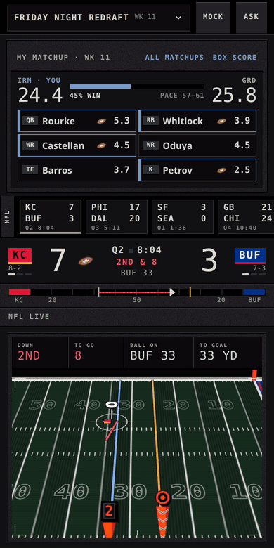
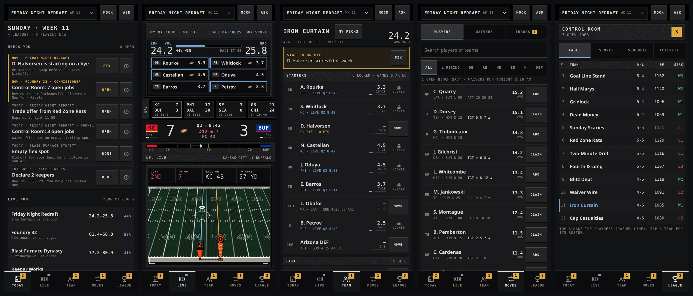
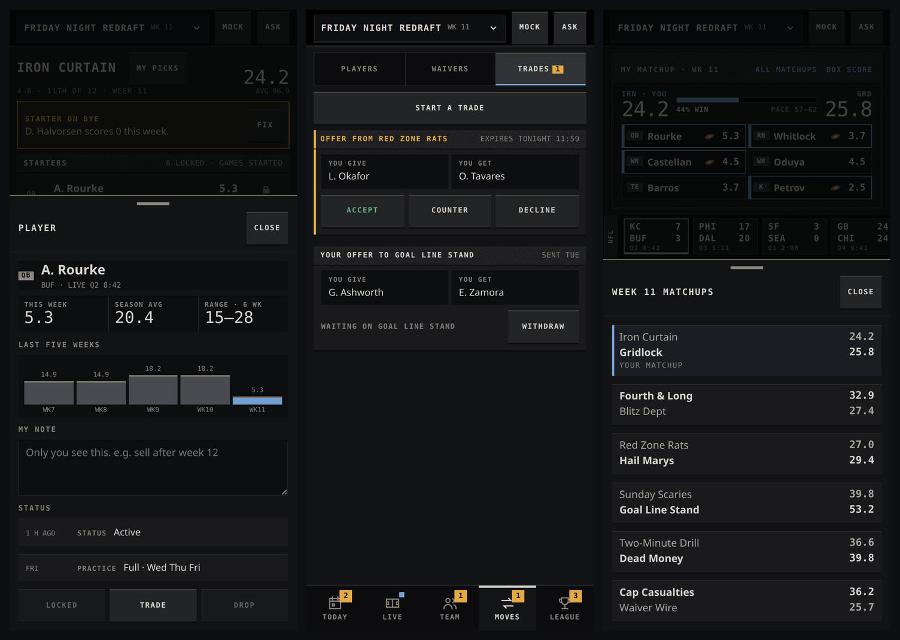
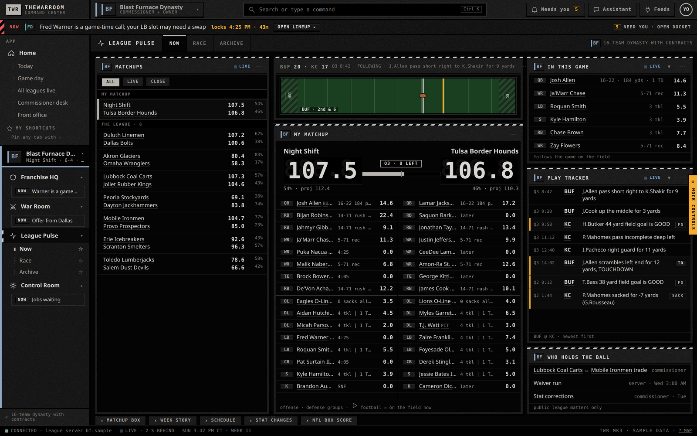
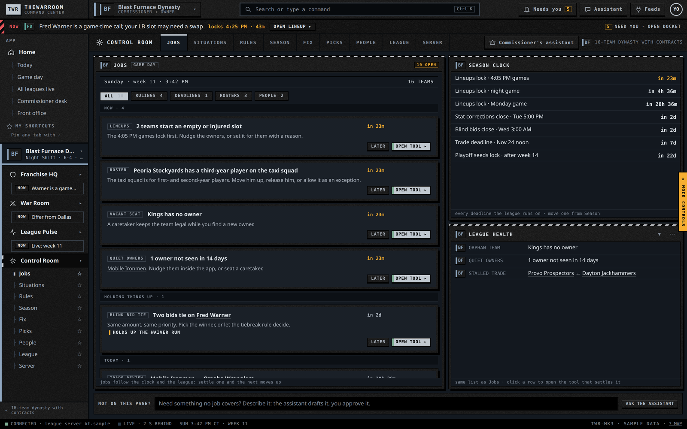

# TheWarRoom

The fantasy football app we always wanted — built for serious dynasty leagues that outgrow
stock platforms and fragile spreadsheets. Your league, every roster, every contract, every
cap dollar, and every rule live in one ledger exact to the penny.

TheWarRoom is AI-first and CLI-first: every move is a typed command in one catalogue, and the
phone app, browser PWA, desktop window, and MCP server all run through the same rules and the
same server-owned clock.

See the full feature tour, architecture diagrams, 32-team default scoring study, and
downloadable browser mocks in [docs/product-tour.md](docs/product-tour.md).

## Why TheWarRoom

No fantasy app does everything well. Serious leagues run on a patchwork: one site to host,
another for trade values, a spreadsheet for contracts, a group chat for the trash talk, and
a payment app for dues. The bigger the league, the worse it gets. A 32-team, two-conference
dynasty league has had one real choice for twenty years, and it looks like 2005.

TheWarRoom replaces the whole patchwork, built first for the leagues everyone else forgot:
**big dynasty leagues** of 20 to 32+ teams, twin player pools, contracts, defensive players,
and decades of history. Redraft and smaller leagues are welcome too.

| What you get | Status |
|:--|:--|
| **One league, one ledger.** Rosters, contracts, cap, picks and every rule, exact to the penny | Built |
| **Live football on your phone.** A live field, big-play moments, matchup win chances | Built, being polished |
| **Your history comes with you.** Import past champions, records and rivalries from ESPN and MFL, and export everything any time. You are never trapped | Next up |
| **Projections built for your scoring.** Real stat-line projections scored by your league's own rules, with a model that knows the backups. In a 32-team league, the third-stringer matters | In progress |
| **One server, one feed.** Every NFL fact is fetched once and shared by every league on the server, so a small box runs many leagues fast | In progress |
| **A Today tab that knows what matters now.** Across all your leagues: waivers closing, a trade waiting, five minutes to kickoff | Designing |
| **Lore that grows with your league.** Trophies that pass from champion to champion like engraved plates, a Hall of Fame, a Tuesday-morning recap in your league's own voice, two power rankings for dynasty (this season and the next three) | Designing |
| **Mini-games that keep last place logged in.** Pick'em, an in-season cup, a stash challenge, bounties. Prizes paid in league currency: picks, FAAB, lottery odds | Planned |
| **A sandbox, not a box.** Rules one tap from the moment they matter, trade review your way, and setup wizards that walk a first-time commissioner through a 32-team league | Planned |

The test: if the commissioner ever quits, the owners love it so much they start their own league.

## Showcase



| Surface | Preview |
|:--|:--|
| Phone tabs |  |
| Phone sheets |  |
| League Pulse |  |
| War Room trade desk |  |
| Franchise HQ |  |
| Control Room |  |

## Where things live

| Need | Location |
|:--|:--|
| Direction & scope | [North_Star.md](North_Star.md), product decisions in [docs/adr/product/](docs/adr/product/README.md) |
| Rules for agents | [CLAUDE.md](CLAUDE.md) (the one entry; see Rules below) |
| Current work (one per workstream) | [docs/resume/](docs/resume/README.md) |
| Architecture decisions | [docs/adr/](docs/adr/README.md) |
| Product words | [GLOSSARY.md](GLOSSARY.md) |
| What exists (two-hop directory) | [SYSTEM_MAP.md](SYSTEM_MAP.md) |
| Old / superseded docs | [docs/archive/INDEX.md](docs/archive/INDEX.md) |
| Full tour & mock downloads | [docs/product-tour.md](docs/product-tour.md) |

Task numbers (T###) are on the one task list, on Hermes: `/home/hermes/work/command-center/Task_list.md`
(read: `ssh hermes`, or the read-only Beelink mirror `~/Documents/Projects/Task_list.md`; write only with
`cc` on Hermes).

## Rules

[CLAUDE.md](CLAUDE.md) is the one rules entry for agents. What the other docs are for:
- [AGENTS.md](AGENTS.md) — advisory guidance on code footprint, security, three-layer imports, and
  stack commands (enforced by hooks and `make lint`).
- [docs/standards/quality-contract.md](docs/standards/quality-contract.md) — how code is written and
  judged, loaded before a build or review.
- [docs/agent-codex.md](docs/agent-codex.md) — older build doctrine, reference only.

## How to run it

Toolchain environment (Go 1.26.11, Node/pnpm, Wails v2 CLI matching `go.mod`):

```sh
export PATH=/usr/local/go/bin:$HOME/go/bin:$HOME/.local/bin:$PATH GOTOOLCHAIN=go1.26.11
export GOMEMLIMIT=1500MiB GOMAXPROCS=8 GOFLAGS="-mod=readonly -buildvcs=false"
export VITEST_MAX_THREADS=2 VITEST_MIN_THREADS=1
```

Setup, checks, and headless startup probe (always pass `VERSION=dev COMMIT=<ring> BUILD_DATE=<ring>`):

```sh
make setup                                 # once per clone: commit and push hooks
make lint                                  # ifaceguard, filelen, bloat, golangci-lint
make test                                  # go test -race ./...
timeout 600 nice -n 10 make verify         # lint, race tests, vuln/bindings, frontend
go build -o /tmp/twr . && /tmp/twr -probe  # headless probe (uses thewarroom-dev.db)
```

Never point a dev build or run a production binary on the Beelink against the real `thewarroom.db`.

## License & ownership

Source-available under [PolyForm Noncommercial 1.0.0](LICENSE), owned by SecureProspective LLC,
with a perpetual free-use grant to Tech Freedom Ministries
([TFM-Grant.md](docs/licensing/TFM-Grant.md)). See [CLA.md](CLA.md),
[CONTRIBUTING.md](CONTRIBUTING.md), and
[README-license-summary.md](docs/licensing/README-license-summary.md).
