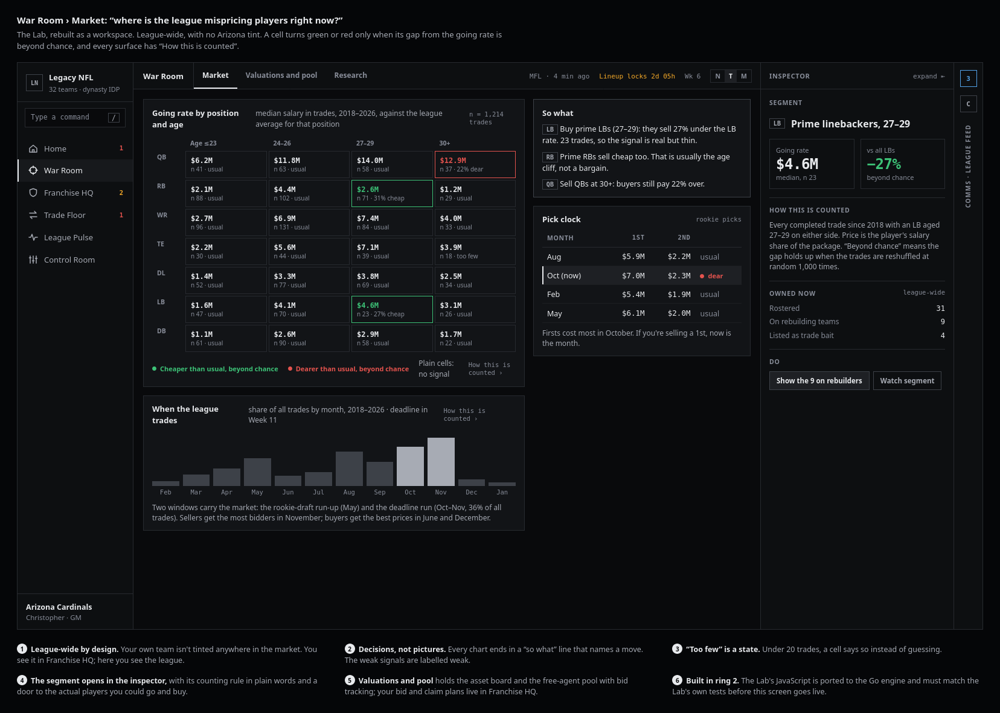
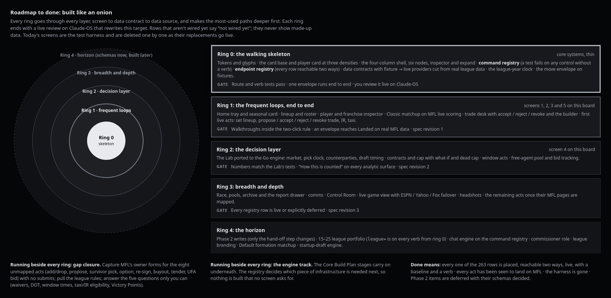

<div align="center">

# 🏈 TheWarRoom

### The Front Office, the League Office and the Stadium Lights — One App, Built for 32-Team Dynasty Football

**A compiled Go engine that knows every player, every contract and every cap dollar in a 32-team dynasty league; fits two numbers to every player on the league's own scoring; and now runs the league itself, on our own server, with every owner signing in from their own desktop.**

<br/>

[](#-the-league-server--built-in-a-sprint-planned-for-seven-months)
[](#-the-road-to-the-draft)

[](https://go.dev)
[](#-two-numbers-per-player)
[](#-the-native-league--the-whole-season-runs-here)
[](#-the-per-year-salary-ledger--exact-to-the-cent)
[](#-the-vault-door--security-you-can-read)
[](#-it-cannot-lose-the-league)
[](#-the-command-line--ai-helpers-with-a-leash)

[](https://wails.io)
[](https://react.dev)
[](https://tailwindcss.com)
[](https://sqlite.org)
[](https://alpinelinux.org)
[](https://cloudflare.com)

*32 teams. Ten position models. Five seasons of history. One league server. **Every owner, one front office.***

</div>

```
 ┌──────────────────────────────────────────────────────────────────────────────┐
 │  THEWARROOM // SYSTEM READOUT                                     2026-10-25 │
 │                                                                              │
 │  ENGINE ......... ONLINE     6 layers · 10 position models · pure & fail-loud│
 │  MODEL .......... FITTED     400 values · 2021–2025 · every piece earned it  │
 │  MEASURABLES .... LIVE       Now + Dynasty · 1,450 players · rookies too     │
 │  HISTORY ........ STORED     ~1M values · 105 measures · append-only         │
 │  LEDGER ......... EXACT      int64 cents · hash-chained · $0.00 drift, ever  │
 │  NATIVE LEAGUE .. HOSTED     draft · lineups · bids · waivers · trades · ✔   │
 │  LEAGUE SERVER .. BUILT      twr-server · Alpine · Cloudflare Tunnel         │
 │  SIGN-IN ........ LOCKED     invite codes · Argon2id · TOTP · device keys    │
 │  BACKUPS ........ ARMED      encrypted · Cloudflare R2 · every 15 minutes    │
 │  DESKTOPS ....... PACKAGED   Windows · Mac · Linux · signed self-updates     │
 │  AI HELPERS ..... LEASHED    twr CLI + MCP · scoped tokens · human confirms  │
 │  CLIENT/SERVER .. 50 / 52    two slices from release-candidate               │
 │  OPENING DAY .... JULY 2027  the rookie draft, run through TheWarRoom        │
 └──────────────────────────────────────────────────────────────────────────────┘
```


<sub>🎯 **The target, Home: "what needs me, and how long do I have?"** The league-year track and its nearest clocks, an alert tray sorted by urgency and then by stakes, and the counterparty open in the inspector. Rough draft r0 of the console TheWarRoom is being built toward. Rosters and contracts are the real league; points, values and clocks are illustrative. [The whole console ↓](#-the-command-console--the-cockpit)</sub>

---

## 📖 Contents

| | | |
|:--|:--|:--|
| ⚡ [The Hook](#-the-hook) | 🧠 [Two Numbers Per Player](#-two-numbers-per-player) | 🚀 [The Front Office](#-the-front-office--feature-showcase) |
| 🏟️ [The League Server](#-the-league-server--built-in-a-sprint-planned-for-seven-months) | 🏈 [The Native League](#-the-native-league--the-whole-season-runs-here) | 🛡️ [The Vault Door](#-the-vault-door--security-you-can-read) |
| 💾 [It Cannot Lose the League](#-it-cannot-lose-the-league) | 📦 [Install & Update](#-install-it-update-it-forget-about-it) | ⌨️ [CLI & AI Helpers](#-the-command-line--ai-helpers-with-a-leash) |
| 🎛️ [The Command Console](#-the-command-console--the-cockpit) | 🏛️ [Architecture](#-the-architecture) | 🗺️ [The Road to the Draft](#-the-road-to-the-draft) |
| 🤖 [The AI Owners](#-horizon--the-ai-owners--the-seat-that-never-goes-empty) | 🤝 [How It Gets Built](#-how-it-gets-built) | 🛠️ [Running It](#-running-it) |

---

## ⚡ The Hook

> MyFantasyLeague gives you a roster and a box score.
> **TheWarRoom gives you a front office — and then it gives the league its own stadium.**

Stock fantasy platforms and fragile spreadsheets fall apart the instant a league gets *serious*: 32 teams, per-year salary caps, multi-year contracts, dead-cap penalties, franchise tags, IDP scoring, and years of history that all have to reconcile to the penny. That's not a fantasy app's job anymore. That's a **data system**.

TheWarRoom started as that data system, a front office for one GM. It pulls the live league, reads five seasons of NFL history into one store, and gives every rostered player **two numbers fitted to *our* league's scoring**: what he's worth this season, and what he's worth to the franchise.

Then it kept going. **TheWarRoom now hosts the league itself.** One server in the homelab holds the one true ledger. It runs the clock, the draft, the bids, the waivers, the trades and the season rollover. Every owner opens the app on their own Windows, Mac or Linux desktop, signs in, and runs their franchise. No monthly platform bill. No one else's servers. **Our league, on our ground.**

### 🏟️ Why 32 teams

The 32-team league is where fantasy football is going. Every NFL franchise has a GM. Rosters run deep, defenses score, the cap bites, and the waiver wire is thin. It's the closest thing to running a real front office, and it's where the serious players are heading. The platforms weren't built for it, and spreadsheets can't keep up with it. **TheWarRoom intends to lead that charge.**

---

## 🧠 Two Numbers Per Player

Every rostered player, rookies included, gets two values, both in **this league's fantasy points per game**:

| | The question it answers |
|:--:|:--|
| 🔥 **Now** | What does he score per game he plays, *this season*? |
| 🏛️ **Dyn** | What is he worth over this season and the next two (each later season counting 0.75 of the one before), times his chance of actually being on the field? |

Both come from one rule, the **credibility blend**: trust a player's production in proportion to how much of it there is.

```
                    ┌──────────────────────────────────────────────┐
   production ────► │  value = Z · production + (1 − Z) · prior    │ ────► 🔥 Now
   (league pts/g)   │                                              │
                    │        Z = games / (games + k)               │ ────► 🏛️ Dyn
   prior ─────────► │  k fitted per position · age via career arcs │   (+ survival,
   (pre-NFL facts)  └──────────────────────────────────────────────┘    3 seasons)
```

- 📊 **Production**: his league points per game as a percentile among the regulars at his position, recent seasons weighted more.
- 🎓 **The prior**: what his pre-NFL facts predict (draft slot, combine, college production, age at entry). It never sees a fantasy point, so it's a true second opinion, not production counted twice.
- ⚖️ **k**: how many games before production outweighs the prior, fitted per position. A kicker's season says far less about his next than a quarterback's does, and the math knows it.
- ⏳ **Age enters once**, through a fitted career arc per position. A 31-year-old running back and a 31-year-old quarterback with identical numbers are valued apart.
- 🐣 **Rookies are never zero.** Until he plays, a rookie is valued on his prior and on the chance a player drafted where he was takes the field.

### 🔬 Fitted, then checked on a season it never saw

The model's **400 values** are fitted on the league's own scoring history, 2021–2025. Every optional piece (the career arc, the recency weights, the survival model, the rookie debut chance) has to **beat its simpler alternative at predicting 2025 with 2025 held out**, or it doesn't ship. Three fits, byte-identical output.

```
   THE HOLDOUT — 2025, predicted blind from data through 2024, against the app's old board
   ─────────────────────────────────────────────────────────────────────────────────────
   TALENT    model wins 9 of 10 positions     RB .76 vs .53 · TE .80 vs .56   (rank corr.)
   ROOKIES   model ranks them .41 – .86       old board: every rookie scored zero
   KICKERS   nobody wins                      a kicker's season barely predicts his next
```

**No hiding the misses.** The kicker result sits in the fit report ([`docs/fit/Fit_Report.md`](docs/fit/Fit_Report.md)) right next to the wins.

Every setting the engine reads (**509 of them**, fitted values and scouting weights included) sits in the **Engine Admin** console, marked fitted or hand-set, and editable. Change one, score the league, and a new run lands beside the old one. **Every earlier run stays readable, forever.**


<sub>🎯 **The target, Franchise HQ › Lineup and roster:** both numbers on every row, next to what the player costs and for how long. Select a player and he opens in the inspector with *his* moves in a tray. Values are illustrative.</sub>

---

## 🚀 The Front Office — Feature Showcase

### 🛰️ Ingestion — *live, end-to-end*
Pipelines pull the **real MFL league** over a rate-limited, host-routed transport and guard every boundary. MFL silently collapses single-element arrays, returns HTTP 200 with error bodies, and omits commissioner-created players; each trap is caught and tested. Everything is normalized into one **type-locked domain state**. `1,450 rostered players · 32 franchises · zero loss · reconciled to the penny.`

### 🗄️ The Data — one history, four free pipelines

Every number lands in **one table**: `player · season · week · measure`. About a **million values from 2021 on**, under **105 measures** named for what they *mean*, never for the source that sent them. The model reads measures, so swapping a source changes zero model code.

| Pipeline | What it brings |
|:--|:--|
| 🟠 [**MyFantasyLeague**](https://www.myfantasyleague.com) | The league's reference record: rosters, contracts, standings, and its scoring of every player, every season since 2021 |
| 🏈 [**nflverse**](https://github.com/nflverse/nflverse-data) | Weekly stats, snaps, injuries, the draft, the combine, and advanced defensive charting |
| 🔗 [**DynastyProcess**](https://github.com/dynastyprocess/data) | The player-id crosswalk that stitches every source together: **124,906 links** |
| 🎓 [**CollegeFootballData**](https://collegefootballdata.com) | College production and school tier |

All four are free. Behind them sits a vetted library of **25 scouting and intelligence sources** ([`docs/sources/Approved_Sources.md`](docs/sources/Approved_Sources.md)), where the next pipelines come from. The **Signals** console shows every feed's coverage by season and position, plus its freshness. And **a lost source never stops the board**: it runs on what still flows and tells you it's running reduced.

### ⚙️ The Valuation Engine — *6 layers, 10 models, and the fitted model beside it*
A framework that crunches *this league's* exact scoring. Nothing is hardcoded; every value is league-sourced or admin-tunable. Six pure-function layers run in order, and **ten position models** are each tuned on their own, because a shutdown corner and a power back are not graded on the same curve.

```
   L1 Data Hygiene   → L2 League Points    → L3 Age Decay
   L4 Scouting Layer → L5 Cap Efficiency   → L6 Tiebreaker
                          ▼
                 ⭐ Adjusted Score           +   🔥 Now · 🏛️ Dyn  (the fitted model)

   QB · RB · WR · TE · DT · DE · LB · CB · S · K   →  10 / 10 LIVE
```

**The scouting layer** reads athleticism, school tier, college production share, breakout age, and, at corner and safety, charted coverage. RAS athleticism is weighted *per position* (gold at receiver, neutral at quarterback). Every threshold was pinned against a live distribution first; the IDP breakout line came out of **25,088 real college defensive player-seasons**. The ones that couldn't be honestly grounded were left neutral rather than faked.

**And when a signal doesn't earn its place, it goes.** Madden's film score sat above the midpoint for *every* rostered player, a flat lift that separated no one, so it was cut with the diff reported. The refactor that made the rubrics editable proved itself bit-identical first: **20,000 generated inputs per position, same hash before and after.**

### 📊 Power Rankings — *two views of the league*
- **🔥 This season**: each roster's summed **Now**, blended with the season's results at a weight you slide.
- **🏛️ The franchise**: each roster's summed **Dyn**, and nothing else. Who's built to win for years, not just this month.

Every board shows each team's **Δ** since the previous model run. Turn a dial in Admin and watch the league reorder.

### 📈 The Market — *where the league misprices*
What every position and age band actually trades for, across every completed trade in league history. A cell turns green or red only when its gap from the going rate holds up beyond chance; a cell with too few trades says so instead of guessing. Every chart ends in a **"so what"** line that names a move, and every surface carries **"How this is counted"** in plain words.



<sub>🎯 **The target, War Room › Market:** going rate by position and age, when the league trades, the pick clock, and a segment open in the inspector with its counting rule. Figures are illustrative.</sub>

### 📒 The Per-Year Salary Ledger — *exact to the cent*
Every contract is a row of **per-year cells**. Every change is an append-only, dated, immutable entry; the database itself rejects an edit to history. The cap is *derived* from the cells (`CapUsed = Σ paid cells + Σ dead cap − Σ cap relief`, floored at 0), never stored as a competing number. **Money is `int64` cents on a flat $10k grid**: no floating-point drift, exact by construction.

### 🔧 The Transaction Engine — *the whole rulebook, enforced*

| Move | What the engine does for you |
|---|---|
| 🔁 **Trades** | Atomic multi-leg swaps. A trade lands *entirely* or rolls back *whole*; a half-executed trade cannot exist |
| ✂️ **Cuts** | §8 dead cap (`35% × salary × years left`) computed and charged on the spot |
| 🏷️ **Franchise tag §9** | Top-5-by-position pricing, 120%-of-prior floor. The screen sends a player, never a dollar |
| 🔧 **Restructure §11** | Cap moves bounded by the rulebook; a violation is *unrepresentable* |
| 📝 **Extension §10 · Buyout §12 · §13–§14** | The full contract rulebook, gated by season phase |
| 🆓 **Free agency §6** | The pool, signings, the §12 buyout lockout, the minimum salary and UFA promotion on rollover |

Priced moves **quote before they commit**: the engine dry-runs the *real* handler and rolls it back, so you see "this will commit" or the exact reason it won't *before* anything is written. You never type a player id or a dollar figure. **Irreversible moves are a hold-to-confirm gesture, never a click.**


<sub>🎯 **The target, Trade Floor › Trade desk:** an incoming offer with its envelope rail, the checks, the league's comparable trades, and the hold-to-accept gate. Real rosters and salaries; values and comparables are illustrative.</sub>

### 🏟️ Game Day — *the matchup, live*
Sunday gets its own surface. The real NFL games run along the top; pick one to follow and the inspector shows its field, its last play and which feed it came from. The centre spine is **fantasy-first**: every play that moves *your* matchup, from any game. Players light up blue while they're on the field.


<sub>🎯 **The target, League Pulse › Now:** the Classic matchup view, every starter's live line, and the scoring plays down the middle. Real rosters; game states and points are illustrative.</sub>

---

## 🏟️ The League Server — Built in a Sprint Planned for Seven Months

> A front office for one is a tool. A front office for the whole league is a **platform.**

In October 2026 the client/server plan was written: **52 slices, about 102 engineer-days**, scheduled to run from late October 2026 to a **build freeze on May 28, 2027**. Five gates were decided by expert panels before a line of server code was written.

**By October 25, 2026, 50 of the 52 slices had landed on `main`.** Each one was reviewed, passed CI, and was squash-merged. The ones you can see were also click-tested in the real app. The two that remain are the final release-blocker drills and the full twelve-owner rehearsal season.

```
   🖥️ Owner desktops ×12+              ☁️ Cloudflare Tunnel               🏠 twr-server
   Windows · Mac · Linux      ──HTTPS──▶   no open ports at home  ◀────────  Alpine container
   your password + device key             no exposed IP                       the ONE ledger
   TOTP for the commissioners             outbound-only tunnel                owns every clock
        ▲                                                                        │
        │  ⚡ live updates: "something changed, re-read"  (never the raw ledger)  │
        └────────────────────────────────────────────────────────────────────────┤
                                                                                 ▼ every 15 min
                                                                    🔒☁️ encrypted backup → Cloudflare R2
```

**One brain, one ledger, one clock.** The engine wasn't rewritten for this. It was built pure from day one, so it simply changed address. The server owns admission time: when you hit *Submit* on a bid at 11:59:59, the **server** decides whether it beat the deadline, and no desktop can fake a clock.

**What the 50 slices built, in order:**

```
   ✅ 01–12  THE SHARED ENGINE     one HTTPS path · typed commands from one catalog ·
                                   one mutation door for trades, bids & waivers ·
                                   server deadline worker · pinned player & stat
                                   evidence · native scoring · replay cache
   ✅ 13–22  ACCOUNTS & SIGN-IN    league accounts · ordered co-commissioners ·
                                   invite codes · Argon2id passwords · TOTP ·
                                   printed recovery codes · device sessions in the
                                   OS keychain · revoke one device, or all of them
   ✅ 23–26  LIVE & PRIVATE        hidden bids stay hidden, even in change tokens ·
                                   private-safe live updates · scoped AI tokens ·
                                   the twr command line + MCP
   ✅ 27–33  HARDENED              toolchain · request & login limits · input guards ·
                                   hash-chained ledger + security audit · saved
                                   checkpoints that catch a rewritten history
   ✅ 34–38  THE APPLIANCE         one-command Alpine installer · sandboxed service ·
                                   encrypted R2 backups · spare-host restore ·
                                   health dashboard + daily checklist
   ✅ 39–42  MOVING DAY            encrypted league export · inactive import ·
                                   seal, activate & reverse a move · safe upgrades
   ✅ 43–45  DELIVERY              free signed updates (TUF) · desktop updater ·
                                   Windows, Mac & Linux packages
   ✅ 46–49  THE OWNER'S SEASON    hosted lineups, rosters & draft · bids, waivers,
                                   trades, results & rollover · MFL reference vs
                                   hosted labels · server-down fails closed
   ✅ 50     THE MATRIX            every command × every role × every helper mode
   ▶  51     RESOURCE & DEPLOY DRILLS   tunnel, input, deployment, update tamper
   ▶  52     THE DRESS REHEARSAL        three-OS novice installs + a full 12-owner season
```

---

## 🏈 The Native League — *the whole season runs here*

The native league is the real thing: a league whose **record of truth is TheWarRoom's own ledger**, not a mirror of somebody else's. Every move is a command, every command is checked against the rulebook, and every result is written once, forever.

| The season | Hosted on the league server |
|:--|:--|
| 🎓 **The rookie draft** | The draft room, the clock and the picks, live for every owner at once |
| 📋 **Lineups & rosters** | Set your lineup, move players to IR and taxi, all legality-checked |
| 💰 **Free-agent bids** | Sealed bids that **nobody can peek at**, not even the commissioner, until the reveal |
| 🔄 **Waivers** | Claims processed by the server at the deadline it owns |
| 🤝 **Trades** | Offered, accepted and landed atomically, both rosters at once |
| 🧮 **Results & standings** | Scored natively from pinned stat evidence, distance bonuses and kicker rules included |
| 📅 **Season rollover** | Contracts age, free agents promote, the new league year opens. One confirmed action, with a receipt |

**Commissioners stay in charge.** The commissioner and every co-commissioner (in a set order of succession) have the full toolkit: corrections recorded as corrections, overrides with a reason, and a "needs a ruling" state when the rulebook runs out. The human decides; the ledger remembers.

**MFL becomes reference.** Screens label exactly where a number came from: **"Your league server"** for the hosted league, **"MFL is reference only"** for the old record. If the league server is unreachable at start-up, the app **fails closed**. It stays on the sign-in screen and never quietly falls back to stale data.

---

## 🛡️ The Vault Door — Security You Can Read

> Every owner trusts this thing with their team. **So every door was locked from the inside before anyone was invited in.**

Security here is **proportionate**: this is a recreational league, so TheWarRoom is built to never be the weak point, without turning a fantasy league into a bank.

| Lock | How it works |
|:--|:--|
| ✉️ **Invite-only** | The commissioner hands you a one-use code, valid 48 hours. No sign-up page exists |
| 🔑 **Passwords** | Hashed with Argon2id, with login throttles and a cap on hashing work so nobody can flood the server |
| 📱 **TOTP for commissioners** | Every commissioner and co-commissioner verifies an authenticator code for anything privileged |
| 🧾 **Recovery codes** | Eight printed one-time codes. Lose your phone, not your franchise |
| 💻 **Device sessions** | Stored in your computer's keychain; idle out at 7 days, hard stop at 30. Revoke one device or all of them, and queued writes die with it |
| 🎭 **Every command knows its role** | All **101 league-changing commands** are checked against owner, commissioner, co-commissioner, DOT and AI-helper modes on every path. Slice 50 proves it with an automated matrix, and a denied attempt changes **nothing** |
| 🙈 **Hidden bids stay hidden** | Not in the screens, not in live updates, not even in the tokens the app uses to detect changes |
| ⛓️ **Tamper-evident history** | The ledger and the security audit are hash-chained. Saved checkpoints catch a rewritten or rolled-back history |
| 🧱 **A sandboxed server** | Non-root, no capabilities, private namespaces, one writable folder. Default-deny firewall; it can't even see the home network |
| 🔗 **A locked supply chain** | Every push scans the whole git history for leaked secrets and audits every dependency. **32 known advisories down to 0** |

---

## 💾 It Cannot Lose the League

```
   ⏱️  RPO  15 minutes     the most play you can ever lose
   🛠️  RTO   4 hours       the longest the league can ever be down, new hardware included
```

- **🔒 Encrypted before it leaves the house.** Every 15 minutes the server seals a matched backup set and ships it to **Cloudflare R2**. A brand-new install won't accept changes until its first off-site set verifies.
- **🚑 Spare-host restore.** A dead server is a runbook, not a disaster: install fresh, run `twr-restore`, and the newest good set comes back. It's compared against the saved checkpoint, and everyone is signed out for a clean start.
- **🔑 A deputy key holder.** The sealed recovery key has a trusted human backup, printed and sealed, off-site.
- **🩺 A health dashboard.** `twr-status` shows backups, history chains, the tunnel, the clock and the disk at a glance, with a daily and away-from-home checklist ([`deploy/server/CHECKLIST.md`](deploy/server/CHECKLIST.md)).
- **🚚 Moving day is safe.** A league can be exported encrypted, imported inactive, sealed at the source, activated at the target, and moved back if needed. A crash at any step leaves exactly one live league.

---

## 📦 Install It, Update It, Forget About It

**For the server host:** one command builds a fresh, isolated Alpine container on Proxmox. It sets up the firewall, the sandboxed service, the TLS keys and the Cloudflare Tunnel, then reboots and proves the whole chain is live before it calls itself installed. **It never modifies the Proxmox host.** ([`deploy/server/README.md`](deploy/server/README.md))

**For owners:** a normal app for **Windows, Mac and Linux**. Install it, paste your invite code, choose a password, done. ([`docs/Owner_Install_Guide.md`](docs/Owner_Install_Guide.md))

**Updates sign themselves for free.** Releases are verified with **TUF**, the same update-integrity framework used across open-source software, so a tampered update is refused. No paid code-signing certificates, so the first install shows the usual "unknown developer" warning, and the guide walks through it. When the server needs a newer app, the desktop shows a clear **update required** screen and stages the update for you. Server upgrades go first, with a read-only preflight and a matched backup before anything changes.

---

## ⌨️ The Command Line — AI Helpers with a Leash

Every button in TheWarRoom is secretly a command, and every command lives in **one catalog**. That catalog generates the typed client, the plain-word grammar and the permission checks, so the screen, the terminal and an AI helper all go through **the exact same door**.

```
   $ twr connect --address https://league.example --league native.example
   $ twr ledger                      # the league's recorded changes
   $ twr preview CHANGE.json         # what a change would do — records nothing
   $ twr execute CHANGE.json         # records it; big moves need the commissioner's code
   $ twr mcp                         # hand the league to an AI helper over MCP
```

A commissioner connects a helper from the app, picks **"look and suggest"** or **"also record"**, and picks which franchise it works for. The helper gets a scoped token: read and preview for 30 days, execute for 24 hours. **An AI never signs in, never makes its own tokens, and never confirms a change on its own.** The ledger marks every move it touches **"via AI"**. ([`cmd/twr/README.md`](cmd/twr/README.md))

---

## 🎛️ The Command Console — The Cockpit

The bar is **Anduril, not SaaS**: dark, precise, data-dense without a pixel of waste. Every button actuates something real.

The console was designed **before** the infrastructure under it, so the build always knows what it's aiming at. Every endpoint that matters was counted (every MFL page and action, every analysis panel, every screen), and each one gets exactly one home, a second route, a command verb and a baseline. **Nothing hides in a "More" menu.**

**The visual system: four jobs, four channels.** Colour says what something *is*. The frame says how much is at stake, from ambient up to irreversible. The countdown says how soon. A monochrome glyph says what kind of thing it is. No channel does two jobs, so a card's gravity reads before a single word does.


**Six places, at most three workspaces each**: Home, War Room, Franchise HQ, Trade Floor, League Pulse and Control Room. The inspector, the command bar, comms, the calendar and the status strip are always present.


- **⚡ Snappy is law.** Every control acknowledges in under 100 ms. Skeletons over spinners, and motion only as feedback.
- **🪜 Three altitudes, one surface.** *Glance* reads the league in seconds from colour alone, *Operate* is the working tier, and *Interrogate* puts every engine number on screen. Depth is **discovered, never demanded**.
- **📅 A real league calendar.** Dragging a deadline doesn't *edit* history; it *appends* a superseding revision.

📐 The spec: [`docs/ui/Target_UI_Spec_2026-10.md`](docs/ui/Target_UI_Spec_2026-10.md) · every endpoint and its verb: [`docs/ui/endpoint-registry.csv`](docs/ui/endpoint-registry.csv) · the interactive board: [`docs/ui/target-draft/`](docs/ui/target-draft/TheWarRoom_Target_Draft_2026-10.html)



---

## 🏛️ The Architecture

The boundaries aren't conventions; they're **compiler-enforced law**. A violation is a *build failure*, not a code-review note.

```
   ┌────────────────────────────────────────────────────────────────────────────┐
   │   OWNER DESKTOPS  ·  Wails v2 + React + Tailwind      ⌨️ twr CLI · 🤖 MCP    │
   │   Home · War Room · Franchise HQ · Trade Floor · League Pulse · Control    │
   └──────────────┬────────────────────────────────────────────┬────────────────┘
                  │  HTTPS + JSON  ·  live change notices       │ scoped tokens
   ┌──────────────▼────────────────────────────────────────────▼────────────────┐
   │   twr-server  ·  sign-in & device sessions  ·  role check on every command  │
   │   ONE catalog of commands  →  ONE mutation door  →  ONE writer               │
   │   server-owned clock  ·  deadline worker  ·  hidden-bid privacy             │
   └──────────────┬──────────────────────────────────────────┬──────────────────┘
                  │                                          │
   ┌──────────────▼───────────────┐          ┌───────────────▼──────────────────┐
   │   THE ENGINE  +  THE MODEL    │          │   THE LEDGER & STORAGE            │
   │   6-layer PURE pipeline       │◄─────────│   SQLite WAL · append-only        │
   │   fitted credibility blend    │  params  │   hash-chained · pinned evidence  │
   │   no db · no net · no files   │          │   encrypted backups → R2          │
   └──────────────▲───────────────┘          └───────────────▲──────────────────┘
                  │                                          │
   ┌──────────────┴──────────────────────────────────────────┴──────────────────┐
   │   INGESTION  ·  MFL (reference) · nflverse · DynastyProcess · CFBD          │
   │   105 measures · id crosswalk · boundary-guarded · fail-loud                │
   └────────────────────────────────────────────────────────────────────────────┘
```

**The laws that hold it together:**

- **One writer.** A single path changes league state, and a planted test *proves* the read-only handle can't be cast back into a writer.
- **A pure engine.** The scoring pipeline and the model touch no database, no network and no files. A linter fails the build if anything dirties them.
- **Immutable history.** Every run records the settings, inputs and engine version it used, and SQLite triggers reject edits. Change the engine, and last season stays exactly as it was scored.
- **Reproducible by construction.** The same history and the same settings give the same values, byte for byte.
- **Forgery-proof IDs.** Player IDs cannot be fabricated; the bypass doesn't compile.
- **A walkable tree.** Every feature lives in `internal/app/<feature>`, and CI fails any file that isn't indexed. Find anything in two hops: [`SYSTEM_MAP.md`](SYSTEM_MAP.md).

```
   BY THE NUMBERS   ~119,000 lines of Go · ~106,000 lines of Go tests · ~56,000 lines of TypeScript
                    603 commits · 20 backend features · 28 frontend surfaces · 101 hosted commands
```

---

## 🗺️ The Road to the Draft

```
   ✅ LAYER 1   THE CORE ─────────────────── fitted model · Now + Dyn · exact ledger
   ✅ BLOCK A   fast push + CI
   ✅ BLOCK 0   the truth pass ──────────── every assumption measured, not guessed
                (ledger replay: 2,000 events from 135 s → 66 ms, about 2,000× faster)
   ✅ BLOCK B   safe today ──────────────── replay fix · Windows · migrations · backups
   ✅ CLIENT/SERVER 01–50 ───────────────── the league server, end to end
   ▶  51–52     the final drills and the 12-owner dress rehearsal
   🔒 MAY 28 2027    build freeze
   ✉️ JUN 25 2027    invitations go out · enrollment by June 30
   🏈 JULY 2027      THE ROOKIE DRAFT — run through TheWarRoom
```

**What's next after the server:**

- 🔄 **The revamp.** With the server built, the next step is a planning session to sharpen everything we've learned. That includes tidying the debt the build logged honestly as it went.
- 📱 **A league on an old phone?** An idea in research: TheWarRoom's server is small enough that an old Android phone on a shelf might host a whole league. Untested, and on the list.
- 🧪 **The parity season.** Before MFL is retired for good, a full season runs in dual record with a discrepancy ledger. **Trust is earned the day the report catches the platform's error, not ours.**
- 🗣️ **The Capologist.** A chat interface on a small local model: *"What's my dead cap in 2028 if I cut him?"*, answered from the actual ledger, **with receipts**.
- 💼 **The Portfolio Desk.** One engine valuing the same player under several leagues' rules at once.
- 🎖️ **The January War Room.** **Fork your franchise** and branch offseason futures like code, each run through the *real* transaction engine.
- 🎟️ **Side games.** Pools, pick'em and survivor are planned, not retired.

### 🤖 Horizon · The AI Owners — the seat that never goes empty

**Finding thirty-two people who will run a franchise with real effort, for years, is genuinely hard.** Owners burn out. Life happens. And when a GM walks, he leaves a franchise shaped by every decision he made.

The append-only ledger is *already* a behavioral record: every bid war, every snipe, every restructure, every cut where a GM ate the dead cap to get free. From it the engine can derive a **GM profile**, not a rating but a *fingerprint*:

| Trait | Read from |
|:--|:--|
| **Risk appetite** | dead cap absorbed, voluntarily |
| **Time horizon** | roster age × remaining contract years |
| **Positional ideology** | where the cap actually goes |
| **Operational fingerprint** | which moves he reaches for, and how often |
| **Timing behavior** | how early, how late, how patient |

**An empty franchise gets a caretaker who plays like the league plays**, and every move still goes through the same role checks, the same phase gate and the same penny-exact ledger as a human. The AI-helper machinery is already built: scoped tokens, "via AI" in the ledger, and a human confirming the big moves. **No AI owner gets a rule a human doesn't get.**

> A 32-team dynasty league shouldn't die because six people got busy.
> **The seat stays filled. The league keeps playing.**

🔭 The vision: [`docs/roadmap/Vision_2026.md`](docs/roadmap/Vision_2026.md) · the client/server plan: [`docs/build-handoffs/Client_Server_Build_Plan_2026-10.md`](docs/build-handoffs/Client_Server_Build_Plan_2026-10.md)

---

## 🤝 How It Gets Built

One human holds the vision and the veto; a crew of AIs builds, and **every claim has to survive real output.**

<div align="center">

[](#)
[](https://anthropic.com)
[-The%20Builder-10A37F?style=for-the-badge&logo=openai&logoColor=white)](https://openai.com)
[-Builder%20·%20Fixer-B45309?style=for-the-badge&logo=anthropic&logoColor=white)](https://anthropic.com)

</div>

| Seat | Who | What they do |
|:--:|:--|:--|
| 🧭 | **Christopher Campbell** | Sets the direction, makes every product call and rules on every open question |
| 🔎 | **Claude** *(Anthropic)* | Lead engineer: writes the plans and briefs, reviews every diff, click-tests in the real app, and merges |
| 🛠️ | **Sol** *(OpenAI GPT)* | Builds the slices from written briefs, test-first, and reports the debt it leaves |
| 🔧 | **Tom** *(Claude Opus)* | Builds overflow slices, fixes what click tests catch, and carries branches forward after each merge |
| 🏛️ | **Expert panels** | Independent model panels ruled on the five client/server gates before any server code existed |

The early phases ran with a full **council**, including **GLM 5.2** as the blind code reviewer, **Gemini** as fresh eyes, **DeepSeek** as the reasoner and **Ornith** running locally. Their fingerprints are still all over the engine and the test suite.

**The rules of the shop:** no work on `main`. Every change is a branch, a PR, green CI and a squash merge. Nothing is called done on an exit code. Anything a person can see is click-tested in the real app on a throwaway copy of the league. Every slice reports the debt it left, and debt gets paid in sweeps.

---

## 🛠️ Running It

To build from source you need **Go 1.26**, **Node with pnpm**, and the **[Wails v2 CLI](https://wails.io/docs/gettingstarted/installation)** matching `go.mod` (currently **v2.13.0**):

```sh
go install github.com/wailsapp/wails/v2/cmd/wails@$(go list -m -f '{{.Version}}' github.com/wailsapp/wails/v2)
make setup     # once per clone: the commit and push hooks
make build     # build/bin/thewarroom — the desktop app
make verify    # lint, race-enabled tests and the frontend build
```

| Program | What it is | Docs |
|:--|:--|:--|
| `thewarroom` | The desktop app every owner runs | [Owner install guide](docs/Owner_Install_Guide.md) |
| `cmd/twr-server` | The league server: hosting, backups, restore, status, upgrades | [`cmd/twr-server/README.md`](cmd/twr-server/README.md) · [`deploy/server/`](deploy/server/README.md) |
| `cmd/twr` | The command line and MCP server for people and AI helpers | [`cmd/twr/README.md`](cmd/twr/README.md) |
| `cmd/twr-practice` | A development-only practice league for click tests on a throwaway copy | [`cmd/twr-practice/README.md`](cmd/twr-practice/README.md) |

Set `CFBD_API_KEY` to a free [CollegeFootballData key](https://collegefootballdata.com/key) for the school-tier signal; without one, that one signal is skipped and everything else runs.

**Status, honestly:** the league server is **preproduction**. It isn't open to real owners until slices 51 and 52 pass, the build freezes on May 28, 2027, and invitations go out in June.

---

## 📜 License & Ownership

**TheWarRoom is source-available, not open-source: free to run and tinker with, never to sell.**

- 🆓 **Free forever for non-commercial use**, under the [**PolyForm Noncommercial License 1.0.0**](LICENSE). Run it, fork it, self-host it, study it, share it.
- 🏛️ **Owned, in full, by SecureProspective LLC** (Texas). All rights reserved.
- 🙏 **Tech Freedom Ministries holds a perpetual, irrevocable, free-use grant**, including commercial use, that **survives any change of ownership.** See [`docs/licensing/TFM-Grant.md`](docs/licensing/TFM-Grant.md).
- 💼 **Commercial use and sale are reserved to SecureProspective.** [Contact SecureProspective](https://secureprospective.com) for terms.
- 🤝 **Contributions welcome** under the [Contributor License Agreement](CLA.md). Start with [`CONTRIBUTING.md`](CONTRIBUTING.md).

> 📖 The whole licensing picture in plain English: [`docs/licensing/README-license-summary.md`](docs/licensing/README-license-summary.md).

---

<div align="center">

*Built by Christopher Campbell with Claude (Anthropic), Sol (OpenAI) and Tom (Claude Opus), on a foundation reviewed, challenged and sharpened by GLM, Gemini, DeepSeek and Ornith.*

**Yesterday, MFL gave us a league and TheWarRoom helped us win it.**

**This July, the league runs on our own server, and every owner walks into the War Room.**

</div>
