<div align="center">

# 🏈 TheWarRoom

### Bring your league. Any size, any rules. Run it from a phone, a desktop, a terminal or an AI.

**TheWarRoom houses your dynasty league: every roster, every contract, every cap dollar and every rule, in one ledger that is exact to the penny. It values every player on your league's own scoring. And everything in it, every single move, is a command that a person or an AI can run.**

<br/>

[](#-bring-your-league)
[](#-ai-first-cli-first)
[](#-the-road-to-the-draft)

[](https://go.dev)
[](#-two-numbers-per-player)
[](#-the-native-league)
[](#-the-native-league)
[](#-the-league-server)
[](#-it-cannot-lose-the-league)
[](#-the-trim)

[](#-the-league-server)
[](https://react.dev)
[](https://wails.io)
[](https://sqlite.org)
[](https://cloudflare.com)

*Every rule is a setting. Every action is a command. **Every owner, one front office.***

</div>

```
 ┌──────────────────────────────────────────────────────────────────────────────┐
 │  THEWARROOM // SYSTEM READOUT                                     2026-11-09 │
 │                                                                              │
 │  IMPORT ......... OPEN       MFL → native · rosters · contracts · picks      │
 │  AI + CLI ....... FIRST      137 commands · twr CLI + MCP · human confirms   │
 │  WEB APP ........ LIVE       phone + browser · join page tested on a phone   │
 │  SPEED .......... MEASURED   screens 106–142 ms · 32 devices · 32-team league│
 │  MODEL .......... FITTED     Now + Dynasty · 2021–2025 · holdout-checked     │
 │  LEDGER ......... EXACT      int64 cents · hash-chained · $0.00 drift        │
 │  NATIVE LEAGUE .. HOSTED     draft · lineups · bids · waivers · trades · ✔   │
 │  LEAGUE SERVER .. BUILT      twr-server · Alpine · Cloudflare Tunnel         │
 │  BACKUPS ........ ARMED      encrypted · Cloudflare R2 · spare-host restore  │
 │  DESKTOPS ....... PACKAGED   Windows · Mac · Linux · signed self-updates     │
 │  THE TRIM ....... −40%       725k → 437k lines · every gate still green      │
 │  OPENING DAY .... JULY 2027  the rookie draft, run through TheWarRoom        │
 └──────────────────────────────────────────────────────────────────────────────┘
```

<div align="center">

[](docs/ui/showcase/TheWarRoom-preview.zip?raw=true)

**[Click to download](docs/ui/showcase/TheWarRoom-preview.zip?raw=true)**, unzip, and open `TheWarRoom-preview.html`. Five screens to explore, nothing to install, and it works offline.

</div>

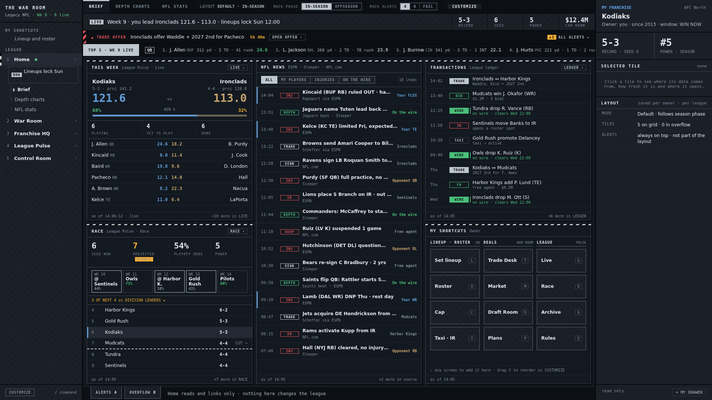

<sub>🏠 **Home: "what needs me, and how long do I have?"** Your matchup live, a trade offer on its clock, the playoff race, league news and every move on the ledger, on one screen. Player names are real; teams, scores and values in the preview are sample data.</sub>

---

## 📖 Contents

| | | |
|:--|:--|:--|
| 🎬 [See It Move](#-see-it-move) | ⚡ [The Hook](#-the-hook) | 🤖 [AI First, CLI First](#-ai-first-cli-first) |
| 🚪 [Bring Your League](#-bring-your-league) | 🧩 [Any League You Can Imagine](#-any-league-you-can-imagine) | 🧠 [Two Numbers Per Player](#-two-numbers-per-player) |
| 🏟️ [The League Server](#-the-league-server) | 🏈 [The Native League](#-the-native-league) | 🔥 [The 32-Team Default](#-the-32-team-default-built-from-the-data) |
| 🛡️ [The Vault Door](#-the-vault-door) | 💾 [It Cannot Lose the League](#-it-cannot-lose-the-league) | 🎛️ [The Console](#-the-console) |
| ✂️ [The Trim](#-the-trim) | 🏛️ [Architecture](#-the-architecture) | 🗺️ [The Road to the Draft](#-the-road-to-the-draft) |
| 🤝 [How It Gets Built](#-how-it-gets-built) | 🛠️ [Running It](#-running-it) |  |

---

## 🎬 See It Move

> **Don't take our word for it. Open it.**

The screens below are not artwork. They are one HTML file you can **[download](docs/ui/showcase/TheWarRoom-preview.zip?raw=true)** and click through right now: five rooms to move between, built in the same look the real app ships in.

**🏟️ League Pulse: game day, the way it should feel.** Your matchup starter by starter, the real NFL game on a field with the ball on it, every other matchup in the league down the side, and a play-by-play spine that only shows the plays that move *your* score.

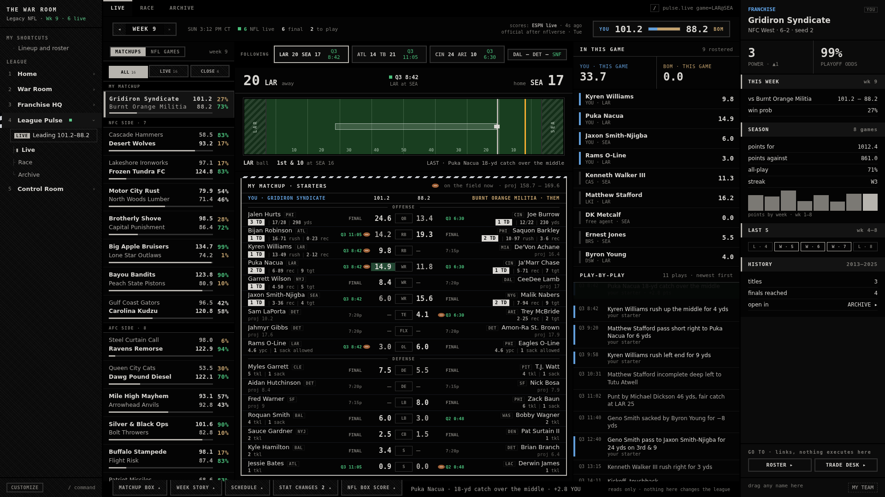

**🤝 The War Room: a trade desk that thinks with you.** Build an offer and see it through **your lens and theirs**. It tells you when both sides win, what the deal does to your cap, your lineup and your next three seasons, and the smallest change that keeps it acceptable.

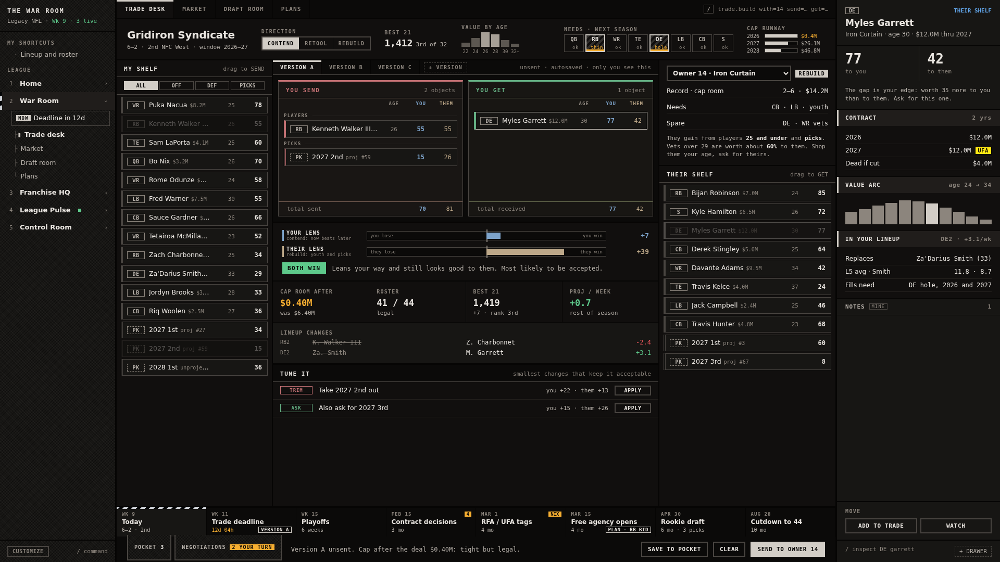

**🏛️ Franchise HQ: your whole team on one page.** Nineteen starters, the bench, cap room and dead money, this week's matchup position by position, and any player open in the inspector with his contract, his age arc and your private notes.

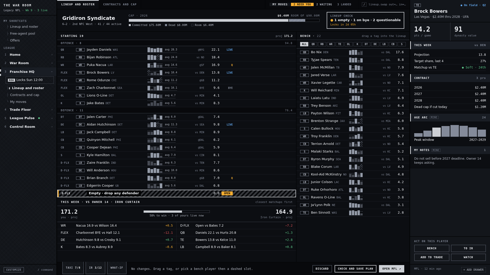

**🎛️ The Control Room: the commissioner's job, finally organised.** Everything that needs a ruling comes to you, sorted by what is due first. Every action previews who it affects, lands on a ledger the owners can read, and can be undone. And at the bottom, the proof of how this whole thing is built: **every screen action is also a command.**

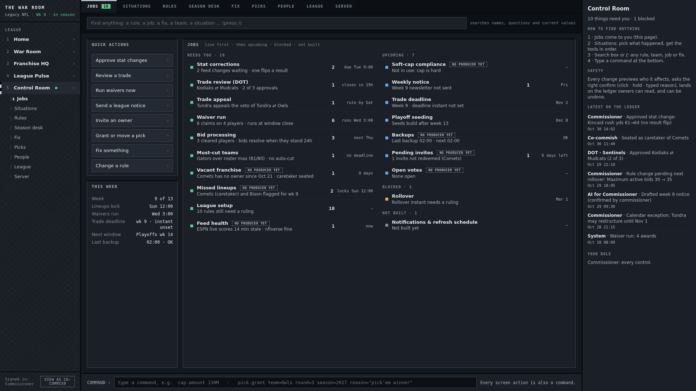

<sub>The preview is a design mock with sample data. A few tiles carry build notes like "no producer yet", because we would rather show you the real state than a polished lie.</sub>

---

## ⚡ The Hook

> MyFantasyLeague gives you a roster and a box score.
> **TheWarRoom gives you a front office, gives the league its own stadium, and hands your AI the keys you choose to give it.**

Stock platforms and fragile spreadsheets fall apart the moment a league gets *serious*: 32 teams, per-year salary caps, multi-year contracts, dead cap, franchise tags, IDP scoring, and years of history that all have to reconcile to the penny. That isn't a fantasy app's job anymore. **That's a data system.**

TheWarRoom is that data system, and it has one job: **be the home your league would be foolish not to move into.**

- 🚪 **Bring the league you already have.** Import it from MFL with its rosters, contracts, picks and rules intact.
- 🧩 **Or build the one you always wanted.** Every rule is a setting. The app doesn't care whether you run 10 teams or 32, one conference or two, with or without a cap.
- 📱 **Play it anywhere.** A phone, a browser, a desktop app, a terminal.
- 🤖 **Let an AI do the busywork.** It works for you, through the same commands you use, and a human confirms anything that changes the league.

No monthly platform bill. No one else's servers. **Your league, on your ground.**

### 🏟️ Why we go all the way to 32 teams

Every NFL franchise gets a GM. Rosters run deep, defenses score, the cap bites, and the waiver wire is thin. It's the closest thing to running a real front office, and it's where the serious players are heading. If the engine holds at 32 teams with contracts and IDP, it holds for your 12-team league without breaking a sweat.

---

## 🤖 AI First, CLI First

> **Every button in TheWarRoom is a command. The screens came second.**

TheWarRoom is built from the command line out. The league runs on **one catalogue of 137 typed commands** behind one door, so a screen, a terminal and an AI helper all reach the same rules, the same checks and the same ledger. The screens you see are an output of that, and so is everything we build next: share cards, minigames, the weekly show.

```
   $ twr connect --address https://league.example --league native.example
   $ twr ledger                      # the league's recorded changes
   $ twr preview CHANGE.json         # what a change would do; records nothing
   $ twr execute CHANGE.json         # records it; big moves need the commissioner's code
   $ twr mcp                         # hand the league to an AI helper over MCP
```

**What that buys you:**

- 🗣️ **Ask, don't click.** "Set my lineup for the bye weeks." "What's my dead cap in 2028 if I cut him?" The helper previews the move through the real rules and shows you the receipt.
- 🧾 **Preview before anything is written.** Every change says "this will commit" or the exact reason it won't.
- 🔐 **A leash, not a free hand.** A commissioner connects a helper, picks **"look and suggest"** or **"also record"**, and picks which franchise it works for. The helper gets a scoped, expiring token. **An AI never signs in, never makes its own tokens, and never confirms a change on its own.**
- 🏷️ **The ledger remembers.** Every move a helper touches is marked **"via AI"**.

([`cmd/twr`](cmd/twr/README.md))

---

## 🚪 Bring Your League

> **Moving your league should be the easiest decision you make all season.**

The import is the front door, and it is built to one standard: **your league lands whole, whatever its size or shape.**

| What comes across | How it lands |
|:--|:--|
| 👥 **Rosters and contracts** | Every player, every salary year, to the cent |
| 🎟️ **Draft picks** | Current and future, with who owns them |
| 📜 **Your rules** | Scoring, lineups, roster limits and cap settings arrive as ordinary settings you can change later |
| 🗂️ **Your season so far** | The schedule, recorded results, transactions and pick history come with it |
| 🏷️ **Franchises and divisions** | Names and structure exactly as your league has them |
| 🪪 **Your owners** | Each one picks their team on a join page and they're in |

- **Nothing is locked because it came from MFL.** An imported league is a normal league. Change any setting the day after you arrive.
- **It checks its own work.** Before you switch, a review compares the import with MFL item by item: rosters, contracts, picks, franchises, divisions and settings. Anything that differs is named in plain words. No silent drops, no "close enough".
- **TheWarRoom never writes to MFL.** Your old league is untouched while you try the new one.

**Not ready to move the whole league?** Use TheWarRoom solo. One owner can point it at their MFL league and get the values, the cap and contract maths and the what-if desk for their own team, with MFL still running the league.

---

## 🧩 Any League You Can Imagine

> **The app houses the settings. A league format is just a set of values.**

Fantasy football is whatever your group decides it is. TheWarRoom frames that instead of fencing it in:

- ⚙️ **Every rule is a setting**, and every setting changes through one flow. Year-over-year rule changes need no new release.
- 🧰 **Presets get you started in minutes.** They suggest values; they never limit them.
- 🧠 **One engine runs them all.** There is no special build for a league type. If you could reach a league by changing settings by hand, the engine can run it.

Two presets ship today:

**🪞 The Mirrored Conference League.** 32 teams, two conferences, **two full player pools**. Each side has its own copy of every NFL player, so both conferences can have someone holding the league's best quarterback. Trades, bids and waivers stay inside your side, the schedule crosses over, and the two side champions meet in one final. It is the simplest way into 32-team dynasty.

**🏛️ The 32-Team Default.** The flagship: deep contracts, per-year caps, IDP, and a lineup, roster and scoring rebuilt from three seasons of play-by-play data. [See how it was built.](#-the-32-team-default-built-from-the-data)

---

## 🧠 Two Numbers Per Player

Every rostered player, rookies included, gets two values, both in **this league's fantasy points per game**:

| | The question it answers |
|:--:|:--|
| 🔥 **Now** | What does he score per game he plays, *this season*? |
| 🏛️ **Dyn** | What is he worth over this season and the next two (each later season counting 0.75 of the one before), times his chance of actually being on the field? |

Both come from one rule, the **credibility blend**: trust a player's production in proportion to how much of it there is.

```
                    ┌──────────────────────────────────────────────┐
   production ────► │  value = Z · production + (1 − Z) · prior    │ ────► 🔥 Now
   (league pts/g)   │                                              │
                    │        Z = games / (games + k)               │ ────► 🏛️ Dyn
   prior ─────────► │  k fitted per position · age via career arcs │   (+ survival,
   (pre-NFL facts)  └──────────────────────────────────────────────┘    3 seasons)
```

- 🎓 **The prior** is what his pre-NFL facts predict: draft slot, combine, college production, age at entry. It never sees a fantasy point, so it's a true second opinion.
- ⚖️ **k** is how many games before production outweighs the prior, fitted per position. A kicker's season says far less about his next than a quarterback's does, and the math knows it.
- ⏳ **Age enters once**, through a fitted career arc per position. A 31-year-old back and a 31-year-old quarterback with identical numbers are valued apart.
- 🐣 **Rookies are never zero.** Until he plays, a rookie is valued on his prior and on the chance a player drafted where he was takes the field.

### 🔬 Fitted, then checked on a season it never saw

The model is fitted on the league's own scoring history, 2021–2025. Every optional piece (the career arc, the recency weights, the survival model, the rookie debut chance) has to **beat its simpler alternative at predicting 2025 with 2025 held out**, or it doesn't ship.

```
   THE HOLDOUT — 2025, predicted blind from data through 2024, against the app's old board
   ─────────────────────────────────────────────────────────────────────────────────────
   TALENT    model wins 9 of 10 positions     RB .76 vs .53 · TE .80 vs .56   (rank corr.)
   ROOKIES   model ranks them .41 – .86       old board: every rookie scored zero
   KICKERS   nobody wins                      a kicker's season barely predicts his next
```

**No hiding the misses.** The kicker result sits in the [fit report](docs/fit/Fit_Report.md) right next to the wins.

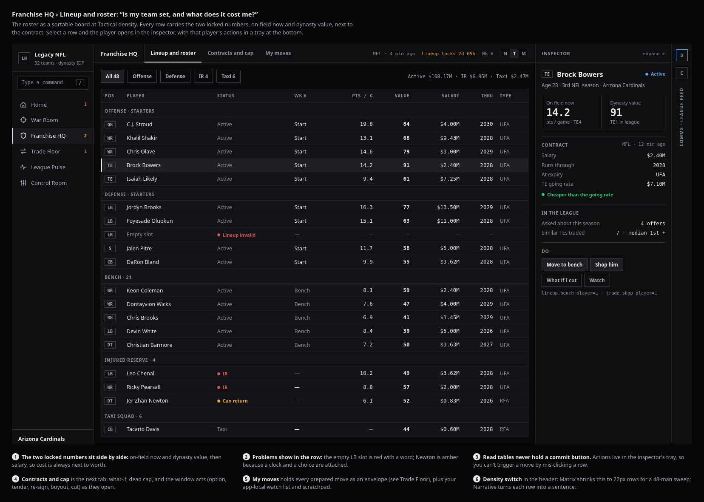

<sub>🎯 **The target, Franchise HQ:** both numbers on every row, next to what the player costs and for how long. Values are illustrative.</sub>

---

## 🏟️ The League Server

> A front office for one is a tool. A front office for the whole league is a **platform.**

One server holds the one true ledger and runs the clock, the draft, the bids, the waivers, the trades and the season rollover. Owners reach it from **a phone or a browser first**, from the desktop app, or from the command line. Same screens, same commands, same rules.

```
   📱 Phones · 🌐 Browsers            ☁️ Cloudflare Tunnel               🏠 twr-server
   🖥️ Desktops · ⌨️ twr CLI · 🤖 AI ──HTTPS──▶ no open ports at home ◀──────  Alpine container
   your sign-in, your team                no exposed IP                       the ONE ledger
                                          outbound-only tunnel                owns every clock
        ▲                                                                        │
        │  ⚡ live updates: "something changed, re-read"  (never the raw ledger)  │
        └────────────────────────────────────────────────────────────────────────┤
                                                                                 ▼
                                                                    🔒☁️ encrypted backup → Cloudflare R2
```

**One brain, one ledger, one clock.** The server owns time. When you hit *Submit* on a bid at 11:59:59, the **server** decides whether it beat the deadline, and no device can fake a clock.

**⚡ Lightning fast is law.** The budget is a screen in under 200 ms and a click in under 100 ms, with no spinners in normal use. Measured on the lab server with a real 32-team league:

```
   SCREENS   p50 106–142 ms at every step up to 32 devices at once      ✅ inside the 200 ms budget
   ERRORS    0 server errors up to 32 devices
   CLICKS    preview ~0.6 s · execute ~0.6 s                             🔧 still over budget, being cut
```

We print the miss next to the win. Clicks are the next thing to fall.

**📲 The join page works on a phone.** An owner opens the link, picks their team from the real imported team names, sets a password and is in. Tested on a real phone over the real tunnel.

| What is built | |
|:--|:--|
| ✅ **The shared engine** | One HTTPS path, typed commands from one catalogue, one mutation door, a server deadline worker, native scoring from pinned stat evidence |
| ✅ **Accounts** | Invite codes, Argon2id passwords, TOTP, printed recovery codes, device sessions, revoke one device or all |
| ✅ **Live and private** | Hidden bids stay hidden everywhere, private-safe live updates, scoped AI tokens, the `twr` CLI and MCP |
| ✅ **Hardened** | Request and login limits, input guards, a hash-chained ledger and security audit, checkpoints that catch a rewritten history |
| ✅ **The appliance** | One-command Alpine installer, sandboxed service, encrypted R2 backups, spare-host restore, health dashboard |
| ✅ **Moving day and delivery** | Encrypted league export and safe moves, free signed updates (TUF), Windows, Mac and Linux packages |
| ✅ **The owner's season** | Hosted lineups, draft, bids, waivers, trades, results and rollover |
| ▶ **Now** | Finishing the browser app, moving the last desktop-only work onto the server, and cutting click times ([the plan](docs/plans/CLIENT-SERVER-PLAN-2026-11-05.md)) |

---

## 🏈 The Native League

The native league is the real thing: a league whose **record of truth is TheWarRoom's own ledger**, not a mirror of somebody else's. Every move is a command, every command is checked against the rulebook, and every result is written once, forever.

| The season | Hosted on the league server, from any device |
|:--|:--|
| 🎓 **The rookie draft** | The draft room, the clock and the picks, live for every owner at once |
| 📋 **Lineups and rosters** | Set your lineup, move players to IR and taxi, all legality-checked |
| 💰 **Free-agent bids** | Sealed bids that **nobody can peek at**, not even the commissioner, until the reveal |
| 🔄 **Waivers** | Claims processed by the server at the deadline it owns |
| 🤝 **Trades** | Offered, accepted and landed atomically: both rosters at once, or neither |
| 🧮 **Results and standings** | Scored natively from pinned stat evidence, distance bonuses and kicker rules included |
| 📅 **Season rollover** | Contracts age, free agents promote, the new league year opens. One confirmed action, with a receipt |

**Money is exact.** Every contract is a row of per-year cells in `int64` cents. The cap is *derived* from those cells, never stored as a competing number. Priced moves **quote before they commit**, so you see "this will commit" or the exact reason it won't before anything is written. **Irreversible moves are a hold-to-confirm gesture, never a click.**

**Commissioners stay in charge.** The commissioner and every co-commissioner, in a set order of succession, have the full toolkit: corrections recorded as corrections, overrides with a reason, and a **"needs a ruling"** state for when the rulebook runs out. The human decides; the ledger remembers.

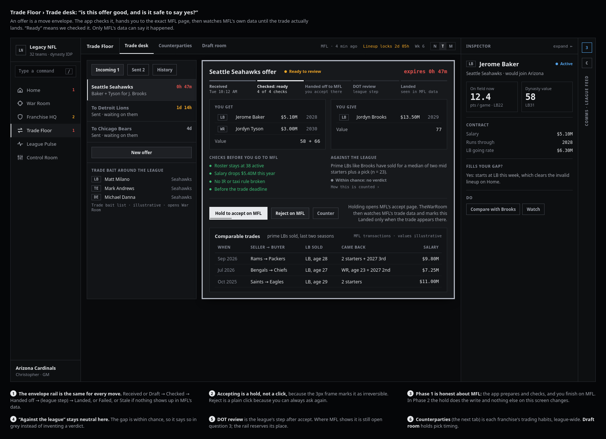

<sub>🎯 **The target, Trade Floor:** an incoming offer with its checks, the league's comparable trades, and the hold-to-accept gate. Real rosters and salaries; values are illustrative.</sub>

---

## 🔥 The 32-Team Default: Built From the Data

**Most fantasy defaults are a guess, copied from the last platform's guess. Ours came out of the data.**

We rescored three full NFL seasons (2023–2025) play by play from free public stats. The rescoring matched our own league's archived scores on **99.9% of more than 35,000 player-weeks**. Then we tested scoring rules one lever at a time against a single question: *how many truly startable players does a 32-team league really have, and is a defender's week worth as much as a receiver's?*

Three rules came out of it:

> 🧨 **Big plays stay big.** Sacks, picks and forced fumbles keep their full value. Special players get to come up big.
> ⚖️ **Match them, don't dampen them.** Defensive splash plays are offset by offensive splash plays: long gains and workhorse games.
> 🧱 **Scarcity does the balancing.** The lineup and roster make good starters hard to find. Scoring is left free to be fun.

### 📋 The lineup: 19 starters, lots of flex

```
  OFFENSE  ·6   [QB] [RB] [WR] [FLEX] [FLEX] [FLEX]          flex = RB / WR / TE
  SPECIAL  ·2   [O-LINE] [K]
  DEFENSE  ·11  [DT] [DE] [LB] [CB] [CB] [S] [FLEX]×5      flex = any defender
```

There are no caps on what fills a flex. Three tight ends? Six safeties? Your call. And like every setting here, it is only the default: a commissioner can reshape the lineup any way they like.

### 👥 The roster: up to 64 deep

| 👥 Active | 🌱 Taxi | 🩹 IR |
|:--:|:--:|:--:|
| **44**, with your O-Line counting as one | **8**, for a player's first 3 NFL seasons only (CFL years don't count) | **12**, official NFL IR or PUP only |
| About 1.3 backups per starter, so byes are covered from your own bench | Moves in-season, and promotes automatically when his time is up | Tradeable, and he returns to active automatically when healthy |

### 🧱 New position: Team O-Line

You start a real NFL team's **entire offensive line**: one unit, scored as a group.

| 🏃 +1 per 25 yards before contact | 💨 +1 per 10+ yard run | 🙌 +1 per rushing TD | 📏 +1 per short-yardage conversion |
|:--:|:--:|:--:|:--:|
| 🛡️ **+2 for a clean game (no sacks)** | 💥 −1 per sack allowed | 🤕 −¼ per QB hit allowed | ⛔ −½ per run stuffed for a loss |

- **It's built to add flavour, not decide your week.** Nine games in ten land between −10 and +10, and every game is capped at ±15.
- **Every team owns exactly one O-Line**, on a 1-year deal. They're traded one for one, and a bye week scores zero, so you have to plan ahead.
- **It's also an early warning for the commissioner.** An owner who never manages his line is an owner drifting away.

### 🚀 Chunk plays pay by the yard

Legacy paid long plays in two flat steps. Now **every yard past 20 adds to the bonus**: +1 at 20 yards, +1.5 at 40 and +2 at 60, and a 99-yard house call earns almost +3.

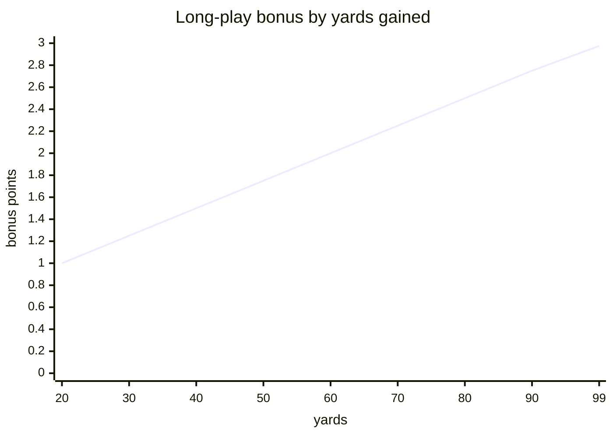

### 🦶 Kickers pay by distance

**Field goals score 3 points up to 40 yards, then +0.1 for every yard past it.** A miss costs −0.1 for every yard short of 60, so shanking a chip shot hurts and missing a 58-yarder barely stings.

| FG distance | 30 | 40 | 45 | 50 | 55 | 60 |
|:--|:--:|:--:|:--:|:--:|:--:|:--:|
| ✅ **Made** | 3.0 | 3.0 | 3.5 | 4.0 | 4.5 | 5.0 |
| ❌ **Missed** | −3.0 | −2.0 | −1.5 | −1.0 | −0.5 | 0 |

### 📊 The scorecard

| 🏈 Offense | Pts | | 🛡️ Defense | Pts |
|:--|:--:|:-:|:--|:--:|
| Rush/rec TD · pass TD | 6 · 5 | | 💥 Sack | **4.5** |
| Catch · **TE catch** 🆕 | 1 · **1.2** | | 🧤 Interception (CB/S 6) | **5** |
| Rush/rec yards | 1 per 10 | | 👊 Forced fumble | **4** |
| 🚀 20+ yard play 🆕 | **+1 → +3** | | ⛔ Tackle for loss | 2.5 |
| 🐎 20+ touches in a game 🆕 | **+3** | | 🤼 Tackle (DT/DE 3, CB/S 2.5) ⬆️ | **2** |
| ↩️ Return yards ⬆️ | **1 per 20** | | 🤝 Assist (DT/DE 1.75) ⬆️ | **1.25** |
| INT thrown · fumble | −2 | | 🙅 Pass defended | 2.5 |
| | | | 🏆 Safety | 10 |

The preset also scores conversions, red-zone work, snaps and other edge stats, plus a weekly
rushing-loss adjustment. See the [shipped scoring spec](docs/architecture/default32-scoring.md)
for values, positions and sources. The study results below predate those additions.

### ⚖️ Offense and defense, finally even

| Average points per starter | 🏈 Offense | 🛡️ Defense | Defense vs offense |
|:--|:--:|:--:|:--:|
| Legacy scoring | 12.9 | 11.6 | 🟥🟥🟥🟥🟥🟥🟥🟥🟥⬜ **0.90** |
| **The new default** | **13.4** | **13.5** | 🟩🟩🟩🟩🟩🟩🟩🟩🟩🟩 **1.00** |

### 🌟 What it means for real players (2024, weeks 1–13)

| Player | Role | Legacy | **Default** | |
|:--|:--|:--:|:--:|:--|
| Saquon Barkley | RB · workhorse | 350 | **379** | 🟦 +29 from 20-touch games and long runs |
| Zaire Franklin | LB · tackle machine | 223 | **276** | 🟥 +53, the defensive match for a star RB |
| A'Shawn Robinson | DT · run stuffer | 166 | **190** | 🟥 +24 |
| Trey Hendrickson | DE · pass rusher | 195 | **209** | 🟥 his 51-point sack-fest is now **53** |
| Ja'Marr Chase | WR · deep threat | 298 | **300** | 🟦 every 20–39 yard catch now pays more |
| Chris Boswell | K · long-range leg | 151 | 142 | 🟩 still the #1 kicker |

**Stars stay stars.** Contenders stock up. Rebuilders take their zeros. That's 32-team football. And like everything in TheWarRoom, **every number here is a default the commissioner can change.**

---

## 🛡️ The Vault Door

> Every owner trusts this thing with their team. **So every door was locked from the inside before anyone was invited in.**

Security here is **proportionate**: this is a recreational league, so TheWarRoom is built to never be the weak point, without turning a fantasy league into a bank.

| Lock | How it works |
|:--|:--|
| ✉️ **Invite-only** | The commissioner hands you a one-use code. There is no open sign-up page |
| 🔑 **Passwords** | Argon2id, login throttles, and a cap on hashing work so nobody can flood the server |
| 📱 **Authenticator codes** | TOTP guards privileged work, and no setting ever skips a permission check or a confirmation |
| 🧾 **Recovery codes** | Printed one-time codes. Lose your phone, not your franchise |
| 💻 **Device sessions** | Revoke one device or all of them, and their queued writes die too |
| 🎭 **Every command knows its role** | Every league-changing command is checked against owner, commissioner, co-commissioner and AI-helper roles on every path. A denied attempt changes **nothing** |
| 🙈 **Hidden bids stay hidden** | Not in the screens, not in live updates, not even in change-detection tokens |
| ⛓️ **Tamper-evident history** | The ledger and the security audit are hash-chained, and checkpoints catch a rewritten history |
| 🧱 **A sandboxed server** | Non-root, no capabilities, one writable folder, default-deny firewall |

---

## 💾 It Cannot Lose the League

> **The league is the rosters and the contracts.** Everything here exists to protect them.

```
   ⏱️  RPO  15 minutes     the most play you can ever lose
   🛠️  RTO   4 hours       the target for the longest the league is ever down, new hardware included
```

- **🔒 Encrypted before it leaves the house.** The server seals a backup on a timer and ships it to **Cloudflare R2**, then reads it back to prove it's good. If a backup goes overdue, the league pauses writes rather than risk them.
- **🚑 Spare-host restore.** A dead server is a runbook, not a disaster: install fresh, run the restore, and the newest good set comes back, checked against the saved checkpoint.
- **🚚 Moving day is safe.** Export a league encrypted, import it inactive, seal the source, activate the target. A crash at any step leaves exactly one live league.
- **🩺 A health dashboard.** `twr-status` shows backups, history chains, the tunnel, the clock and the disk at a glance ([checklist](deploy/server/CHECKLIST.md)).

---

## 🎛️ The Console

The bar is **Anduril, not SaaS**: dark, precise, data-dense, with no wasted pixel. Every control actuates something real. **Plain words for every owner; full depth for every expert.**

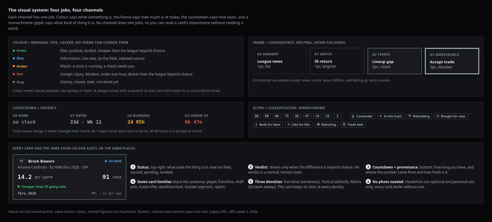

**Four jobs, four channels.** Colour says what something *is*. The frame says how much is at stake. The countdown says how soon. A glyph says what kind of thing it is. No channel does two jobs, so a card's gravity reads before a single word does.

**Six places**: Home, War Room, Franchise HQ, Trade Floor, League Pulse and Control Room, with the inspector, command bar, comms, calendar and status strip always present.

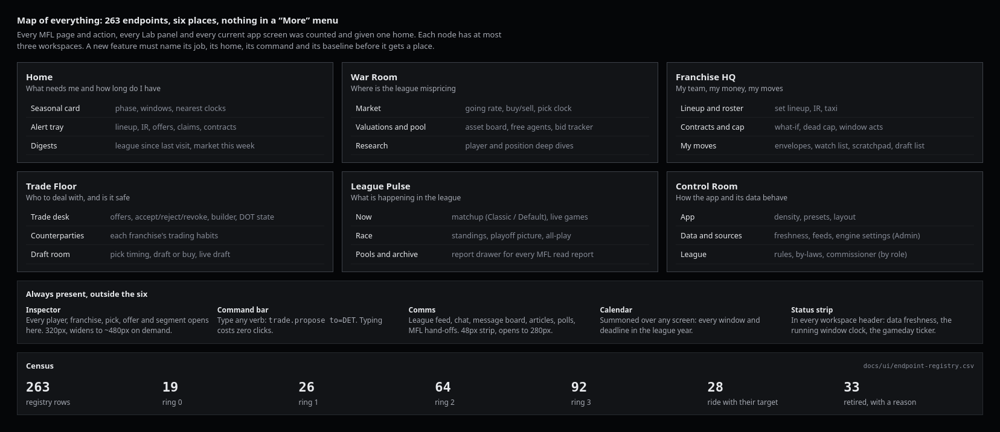

- **⚡ Snappy is law.** Every control acknowledges in under 100 ms. Skeletons over spinners.
- **🪜 Three altitudes.** *Glance* reads the league from colour alone, *Operate* is the working tier, and *Interrogate* puts every number on screen. Depth is **discovered, never demanded**.
- **🏟️ Game Day.** The real NFL games run along the top, and the centre spine shows every play that moves *your* matchup, from any game.

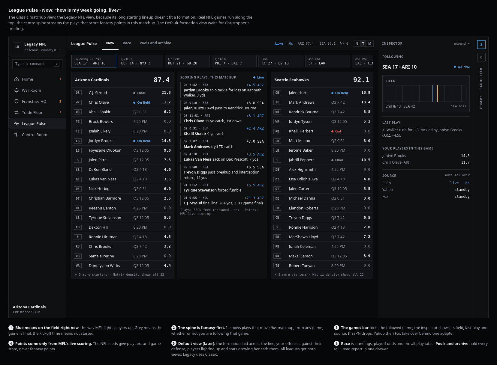

📐 The spec: [`docs/ui/Target_UI_Spec_2026-10.md`](docs/ui/Target_UI_Spec_2026-10.md)

---

## ✂️ The Trim

> We sprinted to a working platform. **Then we cut it to the bone, and it still stands.**

Hundreds of AI build sessions got TheWarRoom to a working league server. They also left a lot behind: tests that had done their job, frozen snapshots, old mock-ups, spent plans. In November 2026 we went back through all of it with one rule: **keep what is good and working, delete the rest, and prove nothing broke.**

```
   BEFORE   725,000 tracked lines
   AFTER    437,000 tracked lines          −40%, with more to come
   ─────────────────────────────────────────────────────────────────────────────
   HOW      spent tests, frozen snapshots and old mock-ups retired first; then every
            remaining Go test was measured for the production lines it exercises,
            and only true duplicates were cut
   KEPT     ledger replay · privacy · durability · contracts · sign-in · the import · the engines
   PROOF    lint, the race-detector suite, the vulnerability scan and the frontend build, all green
```

**Why it matters to you:** less code is a faster app, fewer places for a bug to hide, and a codebase an AI can change safely. The laws don't change: every button is a command, one build serves every league, and **non-technical owners come first without ever limiting the experts.**

---

## 🏛️ The Architecture

The boundaries aren't conventions; they're **enforced by the build**. A violation is a build failure, not a code-review note.

```
   ┌────────────────────────────────────────────────────────────────────────────┐
   │   📱 PHONE + BROWSER (PWA)  ·  🖥️ DESKTOP  ·  ⌨️ twr CLI  ·  🤖 AI over MCP  │
   │   Home · War Room · Franchise HQ · Trade Floor · League Pulse · Control    │
   └──────────────┬────────────────────────────────────────────┬────────────────┘
                  │  HTTPS + JSON  ·  live change notices       │ scoped tokens
   ┌──────────────▼────────────────────────────────────────────▼────────────────┐
   │   twr-server  ·  sign-in & sessions  ·  role check on every command         │
   │   ONE catalogue of commands  →  ONE mutation door  →  ONE writer             │
   │   server-owned clock  ·  deadline worker  ·  hidden-bid privacy             │
   └──────────────┬──────────────────────────────────────────┬──────────────────┘
                  │                                          │
   ┌──────────────▼───────────────┐          ┌───────────────▼──────────────────┐
   │   THE LEAGUE RULES + MODEL    │          │   THE LEDGER & STORAGE            │
   │   rules as settings · legality│◄─────────│   SQLite WAL · append-only        │
   │   fitted credibility blend    │          │   hash-chained · pinned evidence  │
   └──────────────▲───────────────┘          └───────────────▲──────────────────┘
                  │                                          │
   ┌──────────────┴──────────────────────────────────────────┴──────────────────┐
   │   DATA  ·  nflverse · DynastyProcess · CollegeFootballData · MFL import     │
   │   every download saved and fingerprinted before it's read                  │
   └────────────────────────────────────────────────────────────────────────────┘
```

- **One writer.** A single path changes league state.
- **Immutable history.** Every result is appended, never edited, and every model run records the settings and inputs it used.
- **Evidence you can replay.** Every downloaded file is saved and fingerprinted before it's parsed, so any number can be traced to its source.
- **A walkable tree.** Every feature has one home, and CI fails any file that isn't indexed. Find anything in two hops: [`SYSTEM_MAP.md`](SYSTEM_MAP.md).

```
   BY THE NUMBERS   ~139,000 lines of Go · ~87,000 lines of Go tests · ~72,000 lines of TypeScript
                    650+ merged changes · 137 typed league commands · 3 desktop platforms · 1 league server
```

---

## 🗺️ The Road to the Draft

```
   ✅ THE CORE ──────────────────────── fitted model · Now + Dyn · exact ledger
   ✅ THE TRUTH PASS ───────────────── ledger replay: 2,000 events from 135 s → 66 ms
   ✅ THE LEAGUE SERVER ─────────────── hosted season, accounts, backups, packages
   ✅ THE JOIN PAGE ─────────────────── owners pick their team from a phone
   ✅ THE TRIM ──────────────────────── 725k → 437k lines, gates green
   ▶  THE WEB APP, COMPLETE ────────── every owner job from a browser or phone
   ▶  CLICKS UNDER 100 MS ──────────── the last speed budget
   ▶  THE IMPORT, EVERY LEAGUE ─────── any size, any type, lands whole
   🤝 THE FIRST LEAGUE MATES ────────── our own 10–30 owners come in first
   🔒 MAY 28 2027 ─────────────────── build freeze
   ✉️ JUN 25 2027 ─────────────────── invitations go out
   🏈 JULY 2027 ───────────────────── THE ROOKIE DRAFT, run through TheWarRoom
```

**On the horizon:**

- 🎉 **Moments.** Rare, brag-worthy, league-specific share cards, each carrying a "start your own league" link. Facts come from the ledger; AI only phrases them.
- 📰 **The Tuesday wrap-up and Thursday look-ahead**, plus clean printable rosters and cheat sheets.
- 💬 **First-class chat.** Fantasy grew on people talking to each other.
- 🗣️ **The Capologist.** Ask *"What's my dead cap in 2028 if I cut him?"* and get the answer from the actual ledger, **with receipts**.
- 🎖️ **The January War Room.** **Fork your franchise** and branch offseason futures like code, each run through the real rules.
- 🎟️ **Side games.** Pools, pick'em and survivor are planned.

### 🤖 Horizon: the AI Owners

**Finding thirty-two people who will run a franchise with real effort, for years, is hard.** Owners burn out. Life happens.

The append-only ledger is *already* a behavioral record: every bid war, every snipe, every cut where a GM ate the dead cap. From it the engine can derive a **GM fingerprint**: risk appetite, time horizon, where the cap actually goes, how early or late he moves. **An empty franchise gets a caretaker who plays like the league plays**, under the same role checks and the same penny-exact ledger as a human. **No AI owner gets a rule a human doesn't get.**

> A 32-team dynasty league shouldn't die because six people got busy.
> **The seat stays filled. The league keeps playing.**

🔭 [The North Star](North_Star.md) · [The vision](docs/roadmap/Vision_2026.md) · [The client/server plan](docs/plans/CLIENT-SERVER-PLAN-2026-11-05.md) · [What comes after](docs/plans/FUTURE-PLATFORM-DIRECTION-2026-11-08.md)

---

## 🤝 How It Gets Built

One human holds the vision and the veto; a crew of AIs builds, and **every claim has to survive real output.**

<div align="center">

[](#)
[](https://anthropic.com)
[-The%20Builder-10A37F?style=for-the-badge&logo=openai&logoColor=white)](https://openai.com)
[-Builder%20·%20Fixer-B45309?style=for-the-badge&logo=anthropic&logoColor=white)](https://anthropic.com)

</div>

| Seat | Who | What they do |
|:--:|:--|:--|
| 🧭 | **Christopher Campbell** | Sets the direction, makes every product call, rules on every open question |
| 🔎 | **Claude** *(Anthropic)* | Lead engineer: plans, briefs, reviews every diff, click-tests in the real app, merges |
| 🛠️ | **Sol** *(OpenAI GPT)* | Builds from written briefs, test-first, and reports the debt it leaves |
| 🔧 | **Tom** *(Claude Opus)* | Builds overflow, fixes what click tests catch |
| 🏛️ | **Expert panels** | Independent model panels rule on the big, durable decisions |

Earlier phases also ran with **GLM**, **Gemini**, **DeepSeek** and **Ornith** as reviewers and fresh eyes; their fingerprints are all over the engine and the test suite.

**The rules of the shop:** no work on `main`. Every change is a branch, a PR, green CI and a squash merge. Nothing is called done on an exit code. Anything a person can see is click-tested in the real app on a throwaway copy of the league.

---

## 🛠️ Running It

To build from source you need **Go 1.26**, **Node with pnpm**, and the **[Wails v2 CLI](https://wails.io/docs/gettingstarted/installation)** matching `go.mod`:

```sh
go install github.com/wailsapp/wails/v2/cmd/wails@$(go list -m -f '{{.Version}}' github.com/wailsapp/wails/v2)
make setup     # once per clone: the commit and push hooks
make build     # build/bin/thewarroom, the desktop app
make verify    # lint, tests and the frontend build
```

| Program | What it is | Docs |
|:--|:--|:--|
| `cmd/twr-server` | The league server: hosting, the web app, backups, restore, status, upgrades | [`cmd/twr-server`](cmd/twr-server/README.md) · [`deploy/server`](deploy/server/README.md) |
| `cmd/twr` | The command line and MCP server for people and AI helpers | [`cmd/twr`](cmd/twr/README.md) |
| `thewarroom` | The desktop app, for owners who want one and for playing solo | [Owner install guide](docs/Owner_Install_Guide.md) |
| `tools/twr-practice` | A development-only practice league for click tests | [`tools/twr-practice`](tools/twr-practice/README.md) |

**Status, honestly:** TheWarRoom is **preproduction**. The server runs a real 32-team league in the lab and owners can join from a phone. It opens to real owners when the web app is complete, clicks are inside the speed budget and the recovery drills have passed. The build freezes on May 28, 2027, and invitations go out in June.

---

## 📜 License & Ownership

**TheWarRoom is source-available, not open-source: free to run and tinker with, never to sell.**

- 🆓 **Free forever for non-commercial use**, under the [**PolyForm Noncommercial License 1.0.0**](LICENSE).
- 🏛️ **Owned, in full, by SecureProspective LLC** (Texas). All rights reserved.
- 🙏 **Tech Freedom Ministries holds a perpetual, irrevocable, free-use grant**, including commercial use, that survives any change of ownership. See [`docs/licensing/TFM-Grant.md`](docs/licensing/TFM-Grant.md).
- 💼 **Commercial use and sale are reserved to SecureProspective.** [Contact SecureProspective](https://secureprospective.com) for terms.
- 🤝 **Contributions welcome** under the [Contributor License Agreement](CLA.md). Start with [`CONTRIBUTING.md`](CONTRIBUTING.md).

> 📖 The whole licensing picture in plain English: [`docs/licensing/README-license-summary.md`](docs/licensing/README-license-summary.md).

---

<div align="center">

*Built by Christopher Campbell with Claude (Anthropic), Sol (OpenAI) and Tom (Claude).*

**Yesterday, MFL gave us a league and TheWarRoom helped us win it.**

**This July, the league runs on our own server, every owner walks into the War Room, and yours is welcome to follow.**

</div>
